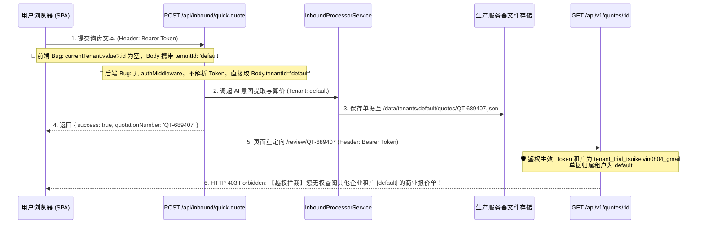

# KelvinFlow 技术调查报告：粘贴询盘建单后被租户越权拦截 (Issue D-12)

> **报告版本**：v1.0 (Ready for AI Agent Review)  
> **调查时间**：2026-10-09  
> **受检环境**：海外生产服 `https://quote.kelvinflow.com` (`192.255.145.11`)  
> **受检账号**：`tsuikelvin0804@gmail.com`  
> **受检租户**：`tenant_trial_tsuikelvin0804_gmail`  
> **调查方式**：服务器底层存储与 API 纯只读检索，无生产数据变动

---

## 1. 核心结论 (TL;DR)
- **根因确凿，前后端双重上下文丢失**：
  1. **前端取属性错误**：[`public/review.html:4550`](file:///F:/order_workflow/public/review.html#L4550) 在 `submitQuickQuoteText` 中向接口传参时，写成了 `tenantId: currentTenant.value?.id || 'default'`。因租户对象的正确键名为 `tenantId`（而非 `id`），导致该表达式始终为 `undefined`，硬编码 Fallback 成了 `'default'`。
  2. **后端路由无身份认证中间件**：接口 `/api/inbound/quick-quote`（[`src/routes/inbound.router.ts`](file:///F:/order_workflow/src/routes/inbound.router.ts)）**未挂载 `authMiddleware`**，未从客户端请求头 `Authorization: Bearer <token>` 提取真实租户，盲目信任了前端请求体传来的 `'default'`。
- **后果**：
  - 新单据被创建在 `default` 租户名下，并使用了 `default` 租户的底价库算价（因没有 TEST 系列底价，全单未匹配）。
  - 出单后前端自动携带登录凭据重定向到 `/review/QT-xxxxxx`。审单接口 `GET /api/v1/quotes/:id` 正确执行了 RBAC/IDOR 鉴权，判定当前登录租户（`tenant_trial_tsuikelvin0804_gmail`）无权查阅 `default` 租户的私有商业单据，**正确抛出 HTTP 403 越权拦截**。
- **对照组验证**：
  - 「载入官方测试单 (Sample PO)」调用的是 `/api/v1/process-quote`（挂载于 `quoteRouter`，有 `authMiddleware`），且单号 `QT-PO-2026-EU-9812` 属于官方样例白名单，会自动克隆至当前租户，因此该路径正常。

---

## 2. 完整调用链与断点定位



---

## 3. 生产环境只读对账证据 (Evidence)

经在生产服务器（`192.255.145.11`）执行只读检索，**确凿查到了 2 笔端到端测试时被错误写入 `default` 租户的 TEST 单据**：

### 错归属单据档案
1. **单号 1**：`QT-633808`
   - **磁盘文件**：`/var/www/quote_app/data/tenants/default/quotes/QT-633808.json`
   - **归属租户**：`"tenantId": "default"`
   - **生成时间**：2026-10-09 02:57 UTC
   - **内容明细**：包含 4 款 TEST 商品（TEST-001 ~ TEST-004）
2. **单号 2**：`QT-689407`
   - **磁盘文件**：`/var/www/quote_app/data/tenants/default/quotes/QT-689407.json`
   - **归属租户**：`"tenantId": "default"`
   - **生成时间**：2026-10-09 02:58 UTC
   - **内容明细**：包含 4 款 TEST 商品（TEST-001 ~ TEST-004）
3. **真实租户目录**：
   - `/var/www/quote_app/data/tenants/tenant_trial_tsuikelvin0804_gmail/quotes/` **为空**，未收到上述单据。

---

## 4. 查验事项逐项答复

### Q1: 粘贴建单完整调用链？
- 前端按钮：[`public/review.html:2237`](file:///F:/order_workflow/public/review.html#L2237) (`@click="submitQuickQuoteText"`)
- 前端发包：[`public/review.html:4544-4552`](file:///F:/order_workflow/public/review.html#L4544-L4552) (`fetch('/api/inbound/quick-quote')`)
- 后端路由：[`src/routes/inbound.router.ts:293`](file:///F:/order_workflow/src/routes/inbound.router.ts#L293) (`inboundRouter.post('/quick-quote')`)
- 业务处理：[`src/services/inbound-processor.service.ts`](file:///F:/order_workflow/src/services/inbound-processor.service.ts)
- 持久化存盘：[`src/services/quote-store.service.ts:32`](file:///F:/order_workflow/src/services/quote-store.service.ts#L32) (`saveQuote`)
- 审单读取：[`src/routes/quote.router.ts:1184`](file:///F:/order_workflow/src/routes/quote.router.ts#L1184) (`GET /api/v1/quotes/:id`)

### Q2: 租户 ID 从哪里取的？与 Sample PO 有何不同？
- **粘贴正文路径**：
  - 后端直接从 `req.body.tenantId` 获取（因缺少 `authMiddleware`）；
  - 前端传的是 `currentTenant.value?.id || 'default'`，取不到值，直接传了 `'default'`。
- **Sample PO 路径**：
  - 调用 `POST /api/v1/process-quote`（挂载了 `authMiddleware`），后端直接从 JWT Token 解析 `req.tenantId`；
  - 且单号 `QT-PO-2026-EU-9812` 在官方样板白名单中，支持无缝克隆。

### Q3: 是否有环节 fallback 到了 [default]？
- **前端与后端双重 Fallback**：
  - 前端第 4550 行：`currentTenant.value?.id || 'default'` 触发了 fallback；
  - 后端第 297 行：`const { tenantId = 'default' } = req.body;` 在未获有效租户时再次触发 fallback。

### Q4: 越权拦截检查本身是否正确？
- **完全正确**。这是防止租户横向越权（IDOR）的核心防线。单据确实属于 `default`，而用户身份是 `tenant_trial_tsuikelvin0804_gmail`，安全网关必须拦截。问题源于上游创建错误，而非下游拦截错误。

### Q5: 数据库中是否产生了 default 的 TEST 单据？
- **是**。已确切查明两笔单据：`QT-633808` 与 `QT-689407`，均保存在 `/var/www/quote_app/data/tenants/default/quotes/` 中。

---

## 5. 修复方案建议 (Actionable Fixes)

### 1. 前端修复：纠正租户键名并增加凭据兜底
在 [`public/review.html`](file:///F:/order_workflow/public/review.html) 的 `submitQuickQuoteText` 构造请求体时：
```javascript
// public/review.html -> submitQuickQuoteText
const userTenantId = 
  currentTenant.value?.tenantId || 
  currentTenant.value?.id || 
  trialState.value?.tenantId || 
  currentUser.value?.tenantId || 
  decodeJwtPayload(token)?.tenantId || 
  'default';

body: JSON.stringify({
  inquiryText: newPoModal.value.rawText,
  emailBody: newPoModal.value.rawText,
  tenantId: userTenantId
})
```

### 2. 后端修复：为入站出单接口增加 Token 租户解析
在 [`src/routes/inbound.router.ts`](file:///F:/order_workflow/src/routes/inbound.router.ts) 的 `/quick-quote` 中优先解析登录身份：
```typescript
// src/routes/inbound.router.ts -> POST /quick-quote
// 优先从 auth 中间件注入的 req.tenantId 或 Authorization Header 解析真实租户
let resolvedTenantId = req.tenantId || req.user?.tenantId;

if (!resolvedTenantId && req.headers.authorization?.startsWith('Bearer ')) {
  const token = req.headers.authorization.split(' ')[1];
  const payload = AuthService.verifyToken(token);
  if (payload) resolvedTenantId = payload.tenantId;
}

const tenantId = resolvedTenantId || req.body.tenantId || 'default';
```

### 3. 数据处理建议
无需数据迁移。这两笔单据（`QT-633808` / `QT-689407`）系测试时因归属错误导致未匹配底价的脏草稿。修复制止后，重新粘贴询盘即可自动在 `tenant_trial_tsuikelvin0804_gmail` 下生成正确关联 10 款底价表的正式单据。历史两笔单据可随时直接清理。
