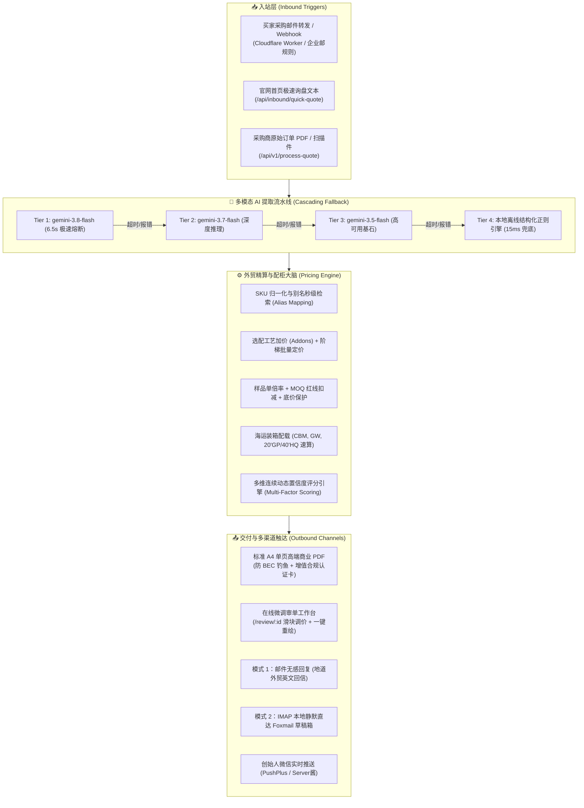
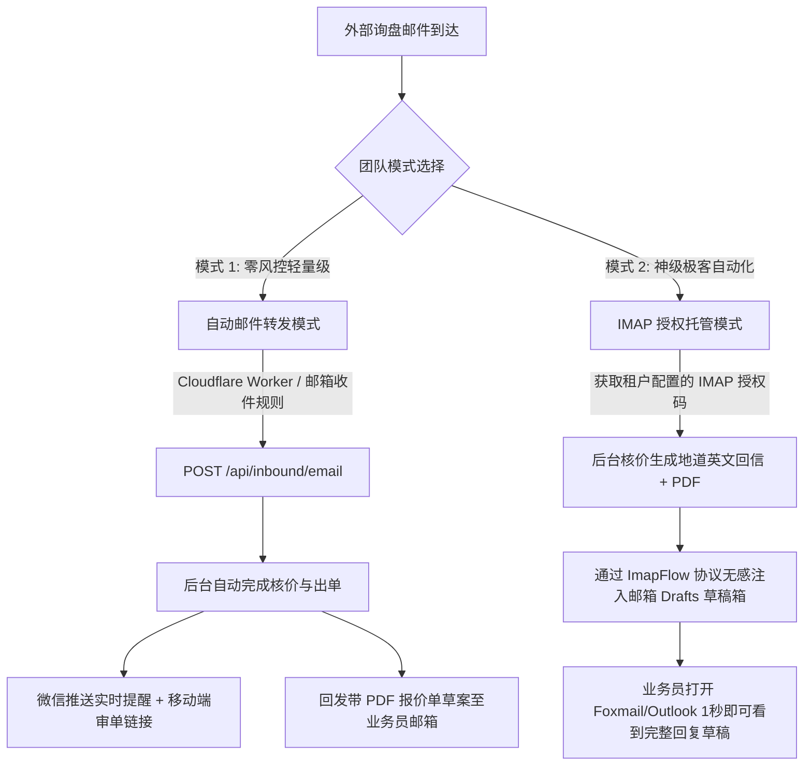

# KelvinFlow AI - 国际外贸智能报价与审单工作流引擎
# 全系统功能架构与自动化测试用例对齐说明书 (System Specification & Testing Blueprint)

> **版本**：v5.0-Enterprise  
> **最后修订时间**：2026-09-30  
> **适用对象**：后续迭代 AI 智能体、全栈架构师、测试工程师、业务主理人  
> **项目根目录**：`F:\order_workflow`  
> **权威地位**：本文档为本项目最高级别的**系统规格契约（Single Source of Truth）**。后续任何 AI 助理在进行代码重构、功能新增或自动化测试用例编写时，**必须 100% 对齐本文档中的业务逻辑、接口契约与风控铁律**。

---

## 目录索引 (Table of Contents)
- [一、 系统定位与整体架构全景 (System Overview & Architecture)](#一-系统定位与整体架构全景)
- [二、 多租户与底层数据存储规范 (Multi-Tenancy & Data Storage Standard)](#二-多租户与底层数据存储规范)
- [三、 核心计算引擎与业务规则库 (Core Engines & Business Rule Specifications)](#三-核心计算引擎与业务规则库)
  - [3.1 多模态 AI 询盘提取流水线 (Gemini AI Extraction Pipeline)](#31-多模态-ai-询盘提取流水线)
  - [3.2 严密外贸成本核算与配柜速算引擎 (Pricing & Container Engine)](#32-严密外贸成本核算与配柜速算引擎)
  - [3.3 商业报价单 PDF 渲染规范与排版预算 (Executive Quotation PDF Engine)](#33-商业报价单-pdf-渲染规范与排版预算)
  - [3.4 双轨入站架构 (Dual Inbound Architecture)](#34-双轨入站架构)
- [四、 Excel 底价表 7-Sheet 标准格式与模糊匹配引擎 (Excel Base Price Specifications)](#四-excel-底价表-7-sheet-标准格式与模糊匹配引擎)
- [五、 全量 RESTful API 接口规格书 (Complete RESTful API Specifications)](#五-全量-restful-api-接口规格书)
- [六、 前端单页应用与审单工作台交互规范 (Web UI & Review Workbench Specification)](#六-前端单页应用与审单工作台交互规范)
- [七、 安全防护、风控与反薅羊毛体系 (Security & Risk Control Specification)](#七-安全防护风控与反薅羊毛体系)
- [八、 未来 AI 测试用例设计全景矩阵 (Testing Blueprint for Future AI Agents)](#八-未来-ai-测试用例设计全景矩阵)
- [九、 AI 协同与二次开发绝对红线 (Strict Engineering Invariants)](#九-ai-协同与二次开发绝对红线)

---

## 一、 系统定位与整体架构全景

### 1.1 业务定位
**KelvinFlow AI** 是专为工贸一体企业、外贸出口制造工厂以及跨境出海团队量身定制的**全自动化询盘解析、成本精算、智能配柜与高转化商业报价单（Formal Quotation）引擎**。

它解决了传统外贸业务三大痛点：
1. **核价极其繁琐**：人工反复查汇率、算毛利、算港口杂费分摊，单次报价平均耗时 1~2 小时；
2. **易算错亏损**：漏算表面处理工艺（如哑光喷涂、激光雕刻）或跌破出厂底价红线；
3. **邮箱安全隐患**：许多海外邮件系统要求提供邮箱账号密码，存在极高封号和 BEC 钓鱼风险。

### 1.2 整体架构拓扑图



### 1.3 技术栈架构
- **运行环境**：Node.js >= 18.0.0 (原生 ESM 模块体系)
- **开发语言**：TypeScript 5.8+ (全量严格类型声明)
- **Web 核心**：Express 4.21+，支持最大 30MB 载荷传输
- **AI 大模型服务**：`@google/generative-ai` 官方 SDK，多阶梯模型智能熔断
- **PDF 渲染引擎**：`pdfkit` 0.16+ 与 `pdfkit-table`，基于物理点阵（pt）的绝对坐标排版算法
- **表格适配器**：`xlsx` + `exceljs`，内置表头语义模糊匹配打分器
- **邮件协议栈**：`imapflow`（高并发 IMAP 客户端）、`nodemailer`（MIME 格式打包与草稿注入）、`mailparser`（入站邮件正文与附件拆解）
- **前端轻量架构**：纯原生 HTML5 + Vue 3 生产单页组件（无需复杂构建工具链，开箱即用）
- **自动化测试**：Jest + ts-jest，配备原生 ESM 与全链路端到端自动化测试套件

---

## 二、 多租户与底层数据存储规范

本项目采用**轻量级文件持久化多租户隔离架构**，无需复杂的外部数据库集群，天然具备灾备、备份、离线迁移和单机极速运行能力。

### 2.1 目录拓扑结构规范

```text
F:\order_workflow\
├── data/
│   ├── active_pricing.xlsx       # 全局默认出厂底价库 (兜底)
│   ├── trials.json               # 7天免费试用与付费租户用户账本
│   ├── inbound_leads.json        # 官网全量留资与高意向客户记录
│   └── tenants/                  # 租户专属隔离沙箱
│       ├── default/              # 默认租户沙箱
│       │   ├── active_pricing.xlsx  # 租户生效底价表
│       │   ├── profile.json         # 租户企业信息、抬头、联系方式
│       │   ├── logo.png             # 租户自定义商业 Logo (可选)
│       │   └── quotes/              # 历史报价单归档
│       │       ├── QT-20260904-888.json  # 报价单元数据
│       │       └── QT-20260904-888.pdf   # 渲染完成的官方商业 PDF
│       └── tenant_trial_13800000001/ # 试用租户独立沙箱 (按手机号派生)
├── 商品底价表/
│   └── 极简出厂底价表_双表.xlsx   # 研发与演示首选用表
```

### 2.2 租户标识 (`tenantId`) 解析机制与优先级
系统通过 `TenantService.resolveTenantId(tenantIdInput, senderEmail)` 自动完成租户安全映射：
1. **显式传入入参**：若传入 11 位手机号（如 `13800000001`），自动映射为规范格式 `tenant_trial_13800000001`；
2. **邮箱域名自动解析**：若从发件人邮箱提取（如 `sales@foshan-hardware.com`），自动识别为独立租户 `foshan-hardware`；
3. **公共邮箱域名防冲突**：对于 `@gmail.com`、`@qq.com`、`@163.com` 等公共邮箱，使用用户名前缀生成专属租户 `tenant_{username}`；
4. **兜底回退**：无法识别时统一回退至 `default` 租户。

### 2.3 底价表文件加载优先级（严禁随意修改）
在执行核价时，`TenantService.getActivePricingBuffer(tenantId)` 严格遵循以下**三级检索链条**：
1. **最高优先级**：用户指定的双表底价库文件 `F:\order_workflow\商品底价表\极简出厂底价表_双表.xlsx`（存在即强制优先使用）；
2. **第二优先级**：租户专有目录下的专属底价表 `data/tenants/{tenantId}/active_pricing.xlsx`；
3. **兜底优先级**：全局共享底价表 `data/active_pricing.xlsx`。

---

## 三、 核心计算引擎与业务规则库

### 3.1 多模态 AI 询盘提取流水线 (Gemini AI Extraction Pipeline)

#### (1) 四阶级联熔断流水线 (Cascading Fallback Pipeline)
为了保证系统在高并发、海外网络抖动或 Google API 限流下的 100% 稳定性，系统实现以下自动降级策略：

| 级别 | 模型名称 | 超时时间 | 适用场景与特性 |
| :--- | :--- | :---: | :--- |
| **Tier 1** | `gemini-3.8-flash` | **6.5s** | 最新一代模型，首选极速解析，超短熔断保障用户无感等待 |
| **Tier 2** | `gemini-3.7-flash` | **8.0s** | 旗舰推理模型，处理复杂版面、非标定制工艺与模糊语义 |
| **Tier 3** | `gemini-3.5-flash` | **10.0s**| 高可用稳定基石，保障基础吞吐与降级防穿透 |
| **Tier 4** | 本地离线规则引擎 | **15ms** | 采用预编译正则与 SKU 字典匹配，在断网极端场景下 100% 不崩单 |

#### (2) 统一输出 JSON Schema 契约
AI 提取后必须满足以下严格类型约束（`POExtractionResult`）：
```json
{
  "ConfidenceScore": 95,
  "MissingInfo": [],
  "IsStandardOrder": true,
  "PONumber": "PO-2026-NORDIC-01",
  "CustomerName": "Nordic Ergonomics AS",
  "Date": "2026-09-30",
  "TotalOrderValue": null,
  "Currency": "USD",
  "DeliveryDetails": "FOB Shenzhen Port, Delivery within 30 days",
  "SpecialRemarks": "Export pallet packaging, pre-shipment inspection required",
  "UncategorizedCriticalInfo": "",
  "BuyerContact": {
    "Name": "Lars Henrik",
    "Email": "purchasing@nordic-ergo.com"
  },
  "Items": [
    {
      "SKU": "ST-2026-A",
      "Description": "Ergonomic Monitor Stand with Matte Black Powder Coating",
      "Quantity": 1500,
      "ConfidenceScore": 98,
      "MatchStatus": "EXACT",
      "ConfidenceRemark": ""
    }
  ]
}
```

#### (3) 核心字段清洗与防干扰规则
- **去客套话机制**：严禁在 `SpecialRemarks` 中提取类似 *"Dear Sir/Madam, we are looking forward to establishing a long-term business relationship..."* 等社交寒暄，仅保留港口、包装、交期、验货等硬性合同约束；
- **工艺归属防错**：单品专属的定制要求（如某款背框做激光雕刻）必须提取并写入对应商品的 `Description`，不得随意提升至订单全局 `SpecialRemarks`。

---

### 3.2 严密外贸成本核算与配柜速算引擎 (Pricing & Container Engine)

#### (1) 国际单价测算核心公式
所有外币单价均由系统自动核算，计算必须精确到分（保留 2 位小数）：

$$\text{TotalRMB} = (\text{EffectiveBasePrice} + \text{TotalAddonRMB}) \times (1 + \text{ProfitMargin}) + \text{FobCostRMB}$$

$$\text{UnitPriceForeign} = \text{round}\left(\frac{\text{TotalRMB}}{\text{RateToRMB}}, 2\right)$$

$$\text{SubTotalForeign} = \text{round}(\text{UnitPriceForeign} \times \text{Quantity}, 2)$$

- **`EffectiveBasePrice` (生效人民币底价)**：
  - 若采购量 $\le 3$ 且底价表配置了 `sampleMultiplier`（如 2.5倍），则：
    $$\text{EffectiveBasePrice} = \text{round}(\text{BasePrice} \times \text{sampleMultiplier}, 2)$$
    并在报价单与审单台打上 `[SAMPLE ORDER]` 标记，注明量产大单时全额返还样品差价；
  - 若命中阶梯 3 起订量（$\ge \text{tier3Qty}$），自动选用优惠底价 `tier3BasePrice`；
  - 若命中阶梯 2 起订量（$\ge \text{tier2Qty}$），自动选用优惠底价 `tier2BasePrice`；
  - 若配置了红线保护价 `floorPrice`，且核算底价低于红线，则**强制锁定为 `floorPrice`**，触发底价防呆拦截。
- **`TotalAddonRMB` (选配工艺加价)**：自动匹配底价表中的 Addons（如喷涂 +5元，激光标 +2元）。
- **`ProfitMargin` (预期毛利率)**：优先采用商品指定毛利率，未指定时采用租户默认毛利率（标准默认 `0.30`，即 30%）。
- **`FobCostRMB` (港口杂费分摊)**：EXW 条款下自动置 0；FOB/CIF 模式下依据规则均摊。

#### (2) 多维连续动态 AI 置信度评分引擎
为了防止业务员盲信 AI 报价，系统对每一款商品实行**五维连续加权评分体系 (0~100 分)**：

$$\text{Score} = (\text{SkuScore} \times 0.45) + (\text{SpecScore} \times 0.30) + (\text{AddonScore} \times 0.10) + (\text{GeminiScore} \times 0.15) - \text{Penalties}$$

1. **SKU 精度分 (`SkuScore`, 权重 45%)**：
   - 100% 字符完全一致：100 分；
   - 归一化字符一致（忽略连字符/大小写）：98 分；
   - 命中买家档案别名（Aliases）：94~96 分；
   - 包含模糊子串：90 分；
   - 未建档仅描述匹配：70 分。
2. **规格语义 Jaccard 相似度 (`SpecScore`, 权重 30%)**：
   - 将买家描述与商品库品名分词，计算交集 Token 重叠率，连续浮动在 75 ~ 100 分。
3. **工艺加成完备度 (`AddonScore`, 权重 10%)**：
   - 成功匹配选配工艺得 98 分，常规无选配得 90 分。
4. **意图理解分 (`GeminiScore`, 权重 15%)**：
   - 由 Gemini 大模型根据版面清晰度直接评分（默认 92 分）。
5. **惩罚项 (`Penalties`)**：
   - **起订量缺口惩罚**：若订单数量低于 MOQ，根据缺口比例最高扣减 18 分；
   - **底价红线触发**：扣减 8 分，并在备注中提示业务员注意出厂利润。

#### (3) 包装箱规、总 CBM 与整柜装载速算
当底价表包含单箱装量 (`pcsPerCtn`) 和单箱体积 (`cbmPerCtn`) 时，引擎自动完成：
- **总箱数**：$\text{TotalCartons} = \sum \lceil \frac{\text{Quantity}}{\text{pcsPerCtn}} \rceil$
- **总体积**：$\text{TotalCBM} = \sum \text{round}(\text{Cartons} \times \text{cbmPerCtn}, 3)$
- **总毛重**：$\text{TotalGW} = \sum \text{round}(\text{Cartons} \times \text{gwPerCtn}, 1)$
- **装柜建议算法**：
  - 若 $\text{TotalCBM} \le 15 \text{ CBM}$：自动推荐 `LCL Consolidation (拼箱散货)`；
  - 若 $15 < \text{TotalCBM} \le 28 \text{ CBM}$：自动推荐 `1x 20'GP Container (整柜约28 CBM)`；
  - 若 $28 < \text{TotalCBM} \le 58 \text{ CBM}$：自动推荐 `1x 40'GP Container (整柜约58 CBM)`；
  - 若 $58 < \text{TotalCBM} \le 68 \text{ CBM}$：自动推荐 `1x 40'HQ Container (高柜约68 CBM)`；
  - 若 $\text{TotalCBM} > 68 \text{ CBM}$：自动组合计算（如 `1x 40'HQ + 1x 20'GP` 或 `2x 40'HQ`）。

---

### 3.3 商业报价单 PDF 渲染规范与排版预算 (Executive Quotation PDF Engine)

#### (1) 物理硬约束指标 (Physical Invariants)
- **纸张标准**：国际标准 A4 页面（宽 `595.28 pt`，高 `841.89 pt`）；
- **页面边距**：左右安全外边距 `32 pt`，上边距 `24 pt`，正文可用宽度：`531 pt`；
- **单页金标准 (One-Page Rule)**：**对于常规 1~4 款商品的报价单，必须严格 100% 锁定在单页 A4 纸内完成渲染，严禁发生单行落入第二页的断页事故**。

#### (2) 页面垂直高度预算分配表 (Vertical Height Budget Table)

```text
┌─────────────────────────────────────────────────────────────┐  0 pt
│ 顶部安全边距 (24 pt)                                        │
├─────────────────────────────────────────────────────────────┤  24 pt
│ 1. 公司 Header 抬头与大标题 (高度预算: 80 pt)                │
│    - 左侧: 品牌 Logo / 企业英文抬头 / 地址 / 电话 / 邮箱    │
│    - 右侧: "COMMERCIAL QUOTATION" 大字 / 报价单号 / 日期   │
├─────────────────────────────────────────────────────────────┤  104 pt
│ 间距: 6 pt                                                  │
├─────────────────────────────────────────────────────────────┤  110 pt
│ 2. 买家与交运信息卡 (高度预算: 64 pt)                       │
│    - 左栏: BUYER / INVOICE TO / 采购联系人 / 企业全称       │
│    - 右栏: INCOTERMS / 目的港 / 结算币种 / 付款条款         │
├─────────────────────────────────────────────────────────────┤  174 pt
│ 间距: 8 pt                                                  │
├─────────────────────────────────────────────────────────────┤  182 pt
│ 3. 商品报价明细表 Table (高度预算: 210 pt, 支持 1~4 行)     │
│    - 表头高度: 22 pt                                        │
│    - 单行商品高度: 38 pt ~ 44 pt (含 SKU、工艺术语、单价)   │
├─────────────────────────────────────────────────────────────┤  392 pt
│ 间距: 8 pt                                                  │
├─────────────────────────────────────────────────────────────┤  400 pt
│ 4. 金额大写与总计栏 Summary (高度预算: 40 pt)               │
│    - 左侧: 国际商会标准美金英文大写 (SAY TOTAL US DOLLARS)  │
│    - 右侧: 突出深蓝色底块加粗外币总计 (TOTAL: USD $xx,xxx)  │
├─────────────────────────────────────────────────────────────┤  440 pt
│ 间距: 8 pt                                                  │
├─────────────────────────────────────────────────────────────┤  448 pt
│ 5. 商业条款与交运装箱卡片 (高度预算: 74 pt)                 │
│    - 支付条款 / 价格有效期 / 生产交期 / 包装规范 / 质保承诺 │
├─────────────────────────────────────────────────────────────┤  522 pt
│ 间距: 8 pt                                                  │
├─────────────────────────────────────────────────────────────┤  530 pt
│ 6. 出口合规与增值权益卡片 (高度预算: 44 pt)                 │
│    - Row 1: 1% 易损备件赠送 / 免费标准出口外箱麦头印制       │
│    - Row 2: 出货前全检报告与照片 / 优惠原产地证 CO 协助      │
│    - 强制单行防溢出: 采用 ellipsis 属性进行物理行截断       │
├─────────────────────────────────────────────────────────────┤  574 pt
│ 间距: 18 pt                                                 │
├─────────────────────────────────────────────────────────────┤  592 pt
│ 7. 订购确认引导与双方签名签章盖章区 (高度预算: 110 pt)       │
│    - 顶部 CTA: "To accept this quotation, please sign..."   │
│    - 左侧: 出口商签字盖章 (Authorized Seller Sign & Stamp)  │
│    - 右侧: 客户确认签回 (Customer Acceptance & Stamp)        │
├─────────────────────────────────────────────────────────────┤  792 pt
│ 底部页脚: 系统生成追踪码与时间戳 (高度预算: 25 pt)          │
├─────────────────────────────────────────────────────────────┤  817 pt
│ 底部安全边距 (24.89 pt)                                     │
└─────────────────────────────────────────────────────────────┘  841.89 pt
```

#### (3) 反 BEC 邮件钓鱼安全防线 (Anti-BEC Architecture)
- **绝对禁令**：在报价单阶段，**严禁印制工厂离岸美金银行账户（SWIFT Code / IBAN）**；
- **业务逻辑**：国际黑客常通过篡改报价单 PDF 上的收款账号进行巨额诈骗。本系统在报价单中用**“出口增值权益保障卡”**替代银行账户；在客户确认回签、开出正规形式发票（Proforma Invoice / PI）时，方可通过双重安全通道下发美金账户。

---

### 3.4 双轨入站架构 (Dual Inbound Architecture)

为了适配不同规模外贸团队的 IT 基础设施与安全偏好，系统提供**双轨出单通道**：



#### 模式 1：邮件无感转发 + 在线微调出单（0 异地风控通道，推荐新用户）
- **操作方式**：业务员在企业邮箱中设置一条简单规则：*“将所有包含 Inquiry/RFQ 的邮件自动抄送至 `rfq-{phone}@quote.kelvinflow.com`”*；
- **核心优势**：不需要提供企业邮箱密码或授权码，杜绝异地登录被腾讯企业邮/阿里企业邮拦截封号的风险。

#### 模式 2：邮箱授权托管 + 静默注入草稿箱（极客出单模式）
- **操作方式**：用户在工作台输入企业邮箱与客户端授权码（IMAP 专用独立密码）；
- **技术实现**：系统通过 `imapflow` 仅使用 `APPEND` 指令将带商业 PDF 附件的英文回复直写进用户的 `Drafts`（草稿箱），**不执行任何邮件删除或外发动作**；
- **用户体验**：外贸业务员早晨打开本地 Foxmail，草稿箱里已经整整齐齐躺好了格式完美、带高质感 PDF 的回信，核对后点击“发送”即可！

---

## 四、 Excel 底价表 7-Sheet 标准格式与模糊匹配引擎

### 4.1 七大标准 Sheet 命名与数据定义规范

系统全面支持以下 7 大标准工作表（中英文命名均可自适应识别）：

| 工作表序号 | 标准表名（中文/英文） | 核心作用与字段说明 |
| :---: | :--- | :--- |
| **Sheet 1** | `商品底價庫` / `Products` | **核心底价表**：SKU型号、买家别名(Aliases)、品名、出厂底价(RMB)、最低保护价、预期毛利率、均摊FOB杂费、起订量(MOQ)、样品倍率、阶梯2/3数量与底价、单箱装量、外箱CBM、单箱毛重、生产交期、海关HS编码。 |
| **Sheet 2** | `選配加價庫` / `Addons` | **定制与工艺选配库**：工艺名称（如黑色粉体喷涂、激光刻字、加厚海绵）、匹配关键词列表、加价金额(RMB)、适用范围（全品类/办公椅/五金支架）。 |
| **Sheet 3** | `貿易術語庫` / `Incoterms` | **国际商会术语杂费库**：术语名称（EXW/FOB/CIF/CFR/DDP）、港口名称（盐田/蛇口/南沙/北仑/洋山）、每票固定报关杂费(RMB)、单件均摊杂费(RMB)。 |
| **Sheet 4** | `裝櫃速算庫` / `Container_Calc`| **海运集装箱参数库**：货柜型号（20'GP/40'GP/40'HQ/45'HQ）、标称容积（28/58/68/78 CBM）、最大承重重量（吨）。 |
| **Sheet 5** | `匯率表` / `Exchange_Rates` | **财务结算汇率库**：外币币种（USD/EUR/GBP/AUD/CAD/JPY）、锁定内部折算汇率（如 7.20、7.85）。 |
| **Sheet 6** | `付款條款庫` / `Payment_Terms`| **外贸账期与风控库**：条款内容（如 100%前T/T、30%订金70%见提单、OA 60天）、价格浮动倍率（直降2%或上浮4.5%）、定金比例。 |
| **Sheet 7** | `默認參數配置` / `Config` | **工厂全局缺省策略**：默认毛利率（0.30）、报价有效期（30天）、默认出货港口、样品政策说明。 |

### 4.2 表头跳行智能嗅探与模糊匹配算法
工厂客户制作的 Excel 往往顶部包含 1~3 行“说明文字”、“制表人”、“保密声明”等非表头行。
- **嗅探算法 (`scoreRowAsHeader`)**：遍历前 10 行，使用多维词典计算每行命中表头关键词的加权分，**自动锁定分数最高的行作为真实数据表头**，跳过顶层说明文本；
- **模糊映射词典 (`matchColumns`)**：支持中英文几十种口语化表头匹配（如“出厂底价”、“厂价”、“成本价”、“Unit Cost”均精准映射至 `basePrice`）。

---

## 五、 全量 RESTful API 接口规格书

所有 API 均统一挂载在 `/api/v1` 及 `/api/inbound` 前缀下。

### 5.1 身份认证与试用生命周期接口

#### 1. 7天免费全功能试用注册
- **端点**：`POST /api/v1/auth/trial-register`
- **权限**：公开（匿名访问，带 IP 频控防刷）
- **请求体 (JSON)**：
  ```json
  {
    "phone": "13800000001",
    "email": "jason@shunde-hardware.com",
    "password": "Password123!",
    "name": "黄振华",
    "company": "顺德精工五金实业",
    "category": "办公家具配件",
    "channelSource": "小红书",
    "ref": "REF-8888"
  }
  ```
- **成功响应 (HTTP 200)**：
  ```json
  {
    "success": true,
    "isNew": true,
    "token": "eyJhbGciOiJIUzI1NiIsInR5cCI6IkpXVCJ9...",
    "tenantId": "tenant_trial_13800000001",
    "remainingDays": 7,
    "expiresAt": "2026-10-07T18:00:00.000Z",
    "user": {
      "userId": "usr_13800000001",
      "email": "jason@shunde-hardware.com",
      "name": "黄振华",
      "role": "admin",
      "tenantId": "tenant_trial_13800000001"
    }
  }
  ```

#### 2. 用户统一登录
- **端点**：`POST /api/v1/auth/login`
- **请求体**：`{ "phone": "13800000001", "password": "Password123!" }` 或 `{ "email": "admin@kelvinflow.com", "password": "..." }`
- **返回**：JWT Token、用户信息、企业档案与套餐到期状态。

#### 3. 试用状态与到期查询
- **端点**：`GET /api/v1/auth/trial-status`
- **请求头**：`Authorization: Bearer <token>` 或 `x-api-key: <key>`
- **返回**：当前租户的剩余可用天数、套餐等级（`trial` / `pro` / `enterprise`）、开通日期。

---

### 5.2 底价库同步与维护接口

#### 1. 上传并同步底价表 (Excel / Google Sheets)
- **端点**：`POST /api/v1/update-pricing`
- **请求类型**：`multipart/form-data` 或 `application/json`
- **请求参数**：
  - `pricing_file`：上传 `.xlsx` 格式文件；
  - `spreadsheet_url`：Google Sheets 在线文档链接（可选）；
  - `tenantId`：目标租户 ID（缺省自动根据 Token 识别）。
- **成功响应 (HTTP 200)**：
  ```json
  {
    "success": true,
    "message": "底价库已成功更新",
    "summary": {
      "itemCount": 5,
      "sampleItems": ["ST-2026-A", "ST-2026-B", "ERG-PRO-V2"],
      "parsedSheets": ["商品底價庫", "選配加價庫", "貿易術語庫", "匯率表"],
      "exchangeRates": [
        { "currency": "USD", "rateToRMB": 7.2 },
        { "currency": "EUR", "rateToRMB": 7.8 }
      ]
    },
    "replyEmail": {
      "subject": "【底价库更新确认】已成功录入 5 款出口商品底价",
      "body": "..."
    }
  }
  ```

---

### 5.3 核心报价与在线审单接口

#### 1. 核心自动报价生成中枢
- **端点**：`POST /api/v1/process-quote`
- **请求类型**：`multipart/form-data` 或 `application/json`
- **入参字段**：
  - `po_file`：采购商 PO 订单 PDF 或图片扫描件（可选）；
  - `inquiry_text`：纯文本英文询盘正文（可选，与 `po_file` 至少二选一）；
  - `tenantId`：租户 ID；
  - `targetProfitMargin`：期望目标毛利率（可选，如 0.35）。
- **核心处理耗时**：AI 解析 (2~5s) + 算价 (15ms) + PDF 渲染 (80ms)
- **成功响应 (HTTP 200)**：
  ```json
  {
    "success": true,
    "quotationNumber": "QT-20260930-888",
    "reviewUrl": "https://quote.kelvinflow.com/review/QT-20260930-888?token=...",
    "modelUsed": "gemini-3.8-flash",
    "quotation": {
      "quotationNumber": "QT-20260930-888",
      "customerName": "Nordic Ergonomics AS",
      "currency": "USD",
      "totalAmountForeign": 38450.00,
      "incotermUsed": "FOB Shenzhen Port",
      "items": [ ... ],
      "containerEstimate": {
        "totalCBM": 26.5,
        "recommendation": "1x 20'GP Container (整柜装载约95%)"
      }
    },
    "pdfBase64": "JVBERi0xLjMKJcTl8uXr...",
    "draftText": "Dear Lars Henrik,\n\nThank you for your inquiry..."
  }
  ```

#### 2. 在线审单数据读取
- **端点**：`GET /api/v1/quotes/:id`
- **返回**：包含未脱敏的内部成本分析（`basePriceRMB`、`profitMargin`、`fobCostRMB`、五维置信度、AI 诊断建议）。仅供授权业务员查看。

#### 3. 审单微调保存与 PDF 即时重新渲染
- **端点**：`POST /api/v1/quotes/:id`
- **作用**：业务员在前端拖动滑块调整毛利率、修改特定 SKU 单价、或补充未匹配 SKU 的价格后，提交至本接口，系统自动重新核算总金额并**毫秒级重绘官方 PDF 报价单**。

#### 4. 报价单商业 PDF 下载/预览
- **端点**：`GET /api/v1/quotes/:id/pdf`
- **返回**：`Content-Type: application/pdf`，直接二进制流输出或在线预览。

---

## 六、 前端单页应用与审单工作台交互规范

### 6.1 官网门户首页 (`public/index.html`)
- **定位**：面向访客和新客户的高转化 Landing Page；
- **核心组件**：
  - 动态导航栏：集成“7天免费试用”、“产品优势”、“对标案例”、“商业定价”；
  - 邀请裂变参数自适应：检测 URL 中的 `?ref=XXXX`，自动弹出已锁定推荐关系的注册窗口；
  - 极速询盘核价体验舱：无需注册即可现场粘贴一段外贸买家询盘文本，体验 3 秒出单。

### 6.2 智能微调审单工作台 (`public/review.html`)
- **访问入口**：`/review/:id?token=...`；
- **安全沙箱**：基于 Vue 3 渲染，未授权或 Token 非法直接跳转登录拦截；
- **界面核心功能区**：
  1. **买家意向总览卡**：展示买家公司名、联系人、询盘日期、贸易条款、货柜装载预估；
  2. **商品明细与改价台**：
     - **置信度指示徽章**：绿色（$\ge 90$分，精确匹配）、黄色（$70\sim 89$分，工艺选配/别名命中）、红色（$<70$分，非标待审）；
     - **底价与利润率隔离展示**：清晰标明出厂成本与当前毛利；
     - **动态调节滑块**：支持全局或单行商品拖动毛利率（10% ~ 60%）实时联动外币售价；
  3. **PDF 即时双屏预览**：左侧修改参数，右侧通过内嵌 PDF 预览器即时热更新；
  4. **外贸地道英文信件生成器**：根据当前核价单自动生成包含详细条款的商务邮件回信模板，支持一键复制到剪贴板。

---

## 七、 安全防护、风控与反薅羊毛体系

### 7.1 成本底价对外强力脱敏原则 (Data Desensitization)
- **绝对铁律**：对外发送的正式商业 PDF 报价单、给海外买家复制的邮件文本中，**绝对严禁包含任何以下敏感字段**：
  - 人民币出厂成本底价 (`basePriceRMB`)
  - 工厂预期毛利率 (`profitMargin`)
  - 港口固定杂费成本 (`fobCostRMB`)
  - AI 内部置信度评分 (`itemConfidenceScore`)
- 只有经过鉴权的内部业务员在审单工作台（`/review/:id`）中方可查看上述利润分析字段。

### 7.2 7天免费试用防薅羊毛机制 (Anti-Scraping & Free-Loader Defense)
1. **多重唯一性校验**：根据 `手机号 + 企业邮箱 + 设备指纹 + IP` 四重校验，同一手机号或邮箱注册过即自动标记为回访登录，拒绝重复发放试用期；
2. **到期强力熔断 (Paywall)**：试用到期（第 8 天起），系统自动拦截所有出单与改价请求，页面弹出“升级为正式商业套餐”指引，并提供创始人微信协助。

### 7.3 邀请裂变防刷机制 (Referral Anti-Fraud)
- 邀请人与被邀请人均可享受额外 +7 天免费试用特权；
- 严禁同一手机号、同一 IP、同一设备指纹进行自我邀请刷天数，触发风控时自动取消奖励天数。

### 7.4 微信即时通知中枢 (PushPlus / ServerChan)
- 任何新用户注册试用、提交留资表单、或完成大额单据生成时，系统自动在 1 秒内通过 HTTP Webhook 将结构化 Markdown 卡片推送到创始人微信端，提示在 15 分钟内跟进客户。

---

## 八、 未来 AI 测试用例设计全景矩阵

后续任何 AI 助理在针对本项目编写自动化测试（Jest / Playwright / E2E 脚本）时，**必须全量覆盖以下 6 大测试用例族**：

### 8.1 单元测试族 (Unit Test Suite)
- [ ] **UT-01: SKU 归一化清洗测试 (`sku-normalizer.ts`)**
  - 断言：`ST-2026-A`、`st_2026.a`、` ST 2026 A ` 均统一输出 `ST2026A`。
- [ ] **UT-02: 表头模糊匹配与打分嗅探 (`schema-matcher.ts`)**
  - 断言：针对带有 2 行说明文字的非标表头，正确识别出数据表头行，并提取 `basePrice`、`profitMargin`。
- [ ] **UT-03: 美金金额英文大写转换 (`numberToWordsUSD`)**
  - 断言：输入 `38450.25`，正确输出 `SAY TOTAL US DOLLARS THIRTY EIGHT THOUSAND FOUR HUNDRED FIFTY AND 25/100 ONLY`。
- [ ] **UT-04: 五维置信度评分数学模型校验**
  - 断言：当商品采购量低于 MOQ 50% 时，计算结果必须包含起订量缺口惩罚并扣分。

### 8.2 业务核算与集成测试族 (Integration Test Suite)
- [ ] **IT-01: 样品单防薅倍率核算**
  - 输入：采购量 2 件，底价 100 元，样品倍率 2.0，毛利 30%，汇率 7.2。
  - 断言：生效底价为 200 元，单价核算为 $(200 \times 1.3) / 7.2 = 36.11$ 美金，并带有 `[SAMPLE ORDER]` 警告。
- [ ] **IT-02: 阶梯批量底价自适应匹配**
  - 输入：采购量 5000 件，触发底价表 Tier 2（底价由 100 元降至 85 元）。
  - 断言：核算单价必须基于 85 元底价计算。
- [ ] **IT-03: 选配工艺加价与品类防误伤测试**
  - 输入：询盘同时订购“办公椅”和“显示器五金支架”，备注中注明“表面做哑光喷涂”。
  - 断言：根据 Addon Scope 规则，加价必须仅施加在五金支架上，办公椅不得被错误加价。
- [ ] **IT-04: 装柜体积与集装箱建议断言**
  - 输入：总外箱体积为 26.5 CBM。
  - 断言：推荐装柜类型必须严格为 `1x 20'GP Container`。

### 8.3 异常容错与降级测试族 (Resilience & Chaos Testing)
- [ ] **RS-01: 未建档 SKU 零漏报安全降级 (Scenario B)**
  - 输入：询盘中包含底价库不存在的型号 `UNKNOWN-MODEL-999`。
  - 断言：系统不得崩溃 500，必须正常输出报价单，将该商品标记为 `NEED_MANUAL_PRICE`，单价置 0，并在审单台提供手动补价输入框。
- [ ] **RS-02: 大模型网络超时熔断降级**
  - 模拟：模拟 `gemini-3.8-flash` 响应超过 6.5s。
  - 断言：系统必须自动无缝降级至 Tier 2 或本地离线规则引擎，最终成功返回解析数据。

### 8.4 多租户与 IDOR 越权安全测试族 (Security & IDOR Testing)
- [ ] **SEC-01: 跨租户查单越权拦截**
  - 输入：租户 A 携带自身 Token 尝试访问租户 B 的报价单 `/api/v1/quotes/QT-TENANT-B-001`。
  - 断言：必须返回 HTTP 403 Forbidden，禁止数据穿透。
- [ ] **SEC-02: 试用到期门禁拦截**
  - 输入：模拟注册时间已满 8 天的试用用户发起核价。
  - 断言：必须返回 HTTP 403 Forbidden，附带 `expired: true`，拒绝生成报价单。

### 8.5 PDF 视觉排版与零溢出回归测试族 (Visual Regression Testing)
- [ ] **PDF-01: 极简订单排版 (1 个 SKU，短条款)**
  - 断言：生成的 PDF 总页数必须严格为 1 页，无大面积空白脱节。
- [ ] **PDF-02: 极限压力排版 (4 个 SKU，含选配工艺、长交期备注、详细港口条款)**
  - 断言：生成的 PDF 总页数**必须严格为 1 页**；底部双方盖章签字栏距纸张底边必须保持 $\ge 24\text{ pt}$ 安全距离，文本框严禁重叠。

---

## 九、 AI 协同与二次开发绝对红线 (Strict Engineering Invariants)

未来任何接入本项目进行开发的 AI 工程师，必须将以下 8 条规则视作不可突破的底线：

1. **绝对单页 A4 铁律**：严禁在 PDF 渲染逻辑中随意放大外边距或扩大卡片间距。增删字段前必须先复核《垂直高度预算表》，任何导致标准单据跨入第 2 页的代码均视为严重 Regression！
2. **严禁将底价泄露给买家**：对外输出的 PDF、Draft 邮件正文中，严禁打印 `basePriceRMB`、`profitMargin` 等工厂底牌数据！
3. **反 BEC 钓鱼红线**：报价单中绝不允许加入银行账户（SWIFT/IBAN）！
4. **双表优先加载机制**：严禁删除或跳过 `F:\order_workflow\商品底价表\极简出厂底价表_双表.xlsx` 的优先检索逻辑！
5. **AI 闭环检验前严禁交付**：AI 修改完代码后，必须在后台自动运行测试脚本，确认通过后方可向主理人汇报，绝不可把主理人当成人工测试机！
6. **动态内容防御**：所有可能变长的人名、企业名、地址、备注，必须配备文本长度保护（`ellipsis: true` 或字号动态缩小），杜绝布局穿透！
7. **数据文件版本隔离**：`data/` 目录下的用户私有数据、线索与配置严禁提交至 GitHub 公开仓库，必须严格由 `.gitignore` 过滤！
8. **中英文字体兼容**：必须保留对 Windows（`simhei.ttf`, `msyh.ttc`）与 Linux 容器（`wqy-zenhei.ttc`, `NotoSansCJK`）字体的自适应兼容，防止线上部署出现汉字方块乱码！

---
*(说明书完结 · 本规范自发布之日起生效，作为 KelvinFlow AI 唯一的工程交付准则)*
