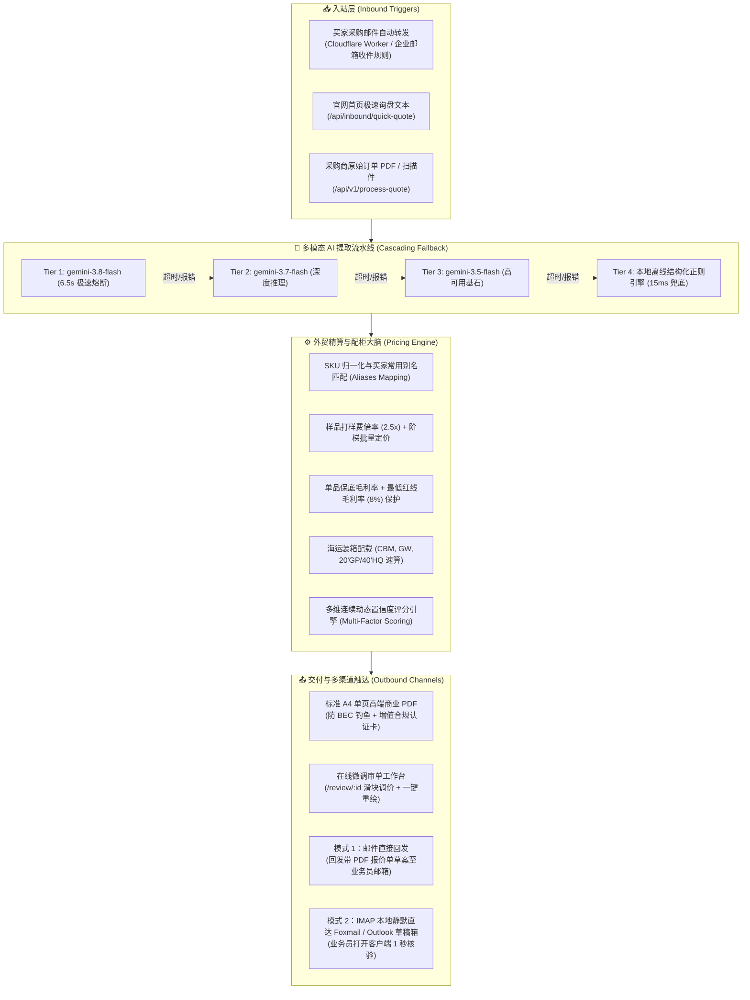
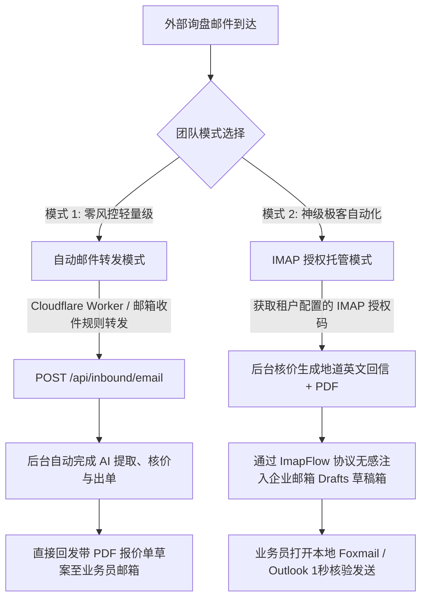

# KelvinFlow AI - 国际外贸智能报价与审单工作流引擎
# 全系统功能架构与自动化测试用例对齐说明书 (System Specification & Testing Blueprint)

> **版本**：v5.1-Enterprise (根据真实业务底价表与流程全面校准)  
> **最后修订时间**：2026-10-01  
> **适用对象**：后续迭代 AI 智能体、全栈架构师、测试工程师、业务主理人  
> **项目根目录**：`F:\order_workflow`  
> **唯一基准底价表目录与生效文件**：`F:\order_workflow\商品底价表\出厂底价表.xlsx`（未来所有底价表更新均在此文件夹下维护，系统自动动态识别）  
> **权威地位**：本文档为本项目最高级别的**系统规格契约（Single Source of Truth）**。后续任何 AI 助理在进行代码重构、功能新增或自动化测试用例编写时，**必须 100% 对齐本文档中的业务逻辑、接口契约与风控铁律**。

---

## 目录索引 (Table of Contents)
- [一、 系统定位与整体架构全景 (System Overview & Architecture)](#一-系统定位与整体架构全景)
- [二、 多租户与底层数据存储规范 (Multi-Tenancy & Data Storage Standard)](#二-多租户与底层数据存储规范)
- [三、 核心计算引擎与业务规则库 (Core Engines & Business Rule Specifications)](#三-核心计算引擎与业务规则库)
  - [3.1 多模态 AI 询盘提取流水线 (Gemini AI Extraction Pipeline)](#31-多模态-ai-询盘提取流水线)
  - [3.2 严密外贸成本核算与配柜速算引擎 (Pricing & Container Engine)](#32-严密外贸成本核算与配柜速算引擎)
  - [3.3 商业报价单 PDF 渲染规范与排版预算 (Executive Quotation PDF Engine)](#33-商业报价单-pdf-渲染规范与排版预算)
  - [3.4 双轨入站架构 (Dual Inbound Architecture)](#34-双轨入站架构)
- [四、 官方极简出厂底价表（标准双表）架构规范 (Excel Base Price Specifications)](#四-官方极简出厂底价表标准双表架构规范)
  - [4.1 标准双表唯一事实与两大工作表定义](#41-标准双表唯一事实与两大工作表定义)
  - [4.2 表头跳行智能嗅探与字段模糊匹配引擎](#42-表头跳行智能嗅探与字段模糊匹配引擎)
- [五、 全量 RESTful API 接口规格书 (Complete RESTful API Specifications)](#五-全量-restful-api-接口规格书)
- [六、 前端单页应用与审单工作台交互规范 (Web UI & Review Workbench Specification)](#六-前端单页应用与审单工作台交互规范)
- [七、 安全防护、风控与数据隔离规范 (Security & Risk Control Specification)](#七-安全防护风控与数据隔离规范)
- [八、 未来 AI 测试用例设计全景矩阵 (Testing Blueprint for Future AI Agents)](#八-未来-ai-测试用例设计全景矩阵)
- [九、 AI 协同与二次开发绝对红线 (Strict Engineering Invariants)](#九-ai-协同与二次开发绝对红线)

---

## 一、 系统定位与整体架构全景

### 1.1 业务定位
**KelvinFlow AI** 是专为工贸一体企业、外贸出口制造工厂以及跨境出海团队量身定制的**全自动化询盘解析、成本精算、智能配柜与高转化商业报价单（Formal Quotation）引擎**。

它解决了传统外贸业务三大痛点：
1. **核价极其繁琐**：人工反复查汇率、算毛利、算港口杂费分摊，单次报价平均耗时 1~2 小时；
2. **易算错亏损**：漏算装柜体积、跌破出厂保底底价红线；
3. **邮箱安全隐患**：许多海外邮件系统要求提供邮箱账号密码，存在极高封号和 BEC 钓鱼风险。

### 1.2 整体架构拓扑图



> [!IMPORTANT]
> **关于出单交付渠道的明确铁律**：
> 系统目前**完全没有接入微信推送（PushPlus / Server酱 等）通知**！在自动邮件转发模式中，后台自动完成核价与出单后，系统**仅通过邮件通道直接回发带 PDF 报价单草案至业务员邮箱**，或通过 IMAP 直投草稿箱，绝不消耗任何个人微信推送额度。

### 1.3 技术栈架构
- **运行环境**：Node.js >= 18.0.0 (原生 ESM 模块体系)
- **开发语言**：TypeScript 5.8+ (全量严格类型声明)
- **Web 核心**：Express 4.21+，支持最大 30MB 载荷传输
- **AI 大模型服务**：`@google/generative-ai` 官方 SDK，多阶梯模型智能熔断
- **PDF 渲染引擎**：`pdfkit` 0.16+ 与 `pdfkit-table`，基于物理点阵（pt）的绝对坐标排版算法
- **表格适配器**：`xlsx` + `exceljs`，内置表头语义模糊匹配打分器
- **邮件协议栈**：`imapflow`（高并发 IMAP 客户端）、`nodemailer`（MIME 格式打包与草稿注入）、`mailparser`（入站邮件正文与附件拆解）
- **前端轻量架构**：纯原生 HTML5 + Vue 3 生产单页组件（无需复杂构建工具链，开箱即用）
- **自动化测试**：Jest + ts-jest，配置 `--runInBand` 原生 ESM 全链路测试套件

---

## 二、 多租户与底层数据存储规范

本项目采用**轻量级文件持久化多租户隔离架构**，无需复杂的外部数据库集群，天然具备灾备、备份、离线迁移和单机极速运行能力。

### 2.1 目录拓扑结构规范

```text
F:\order_workflow\
├── 商品底价表/
│   └── 出厂底价表.xlsx   # [唯一基准维护目录] 官方标准出厂底价表 (未来所有底价表更新均放在此目录)
├── data/
│   ├── trials.json               # 7 天免费试用与注册账本
│   ├── inbound_leads.json        # 留资线索记录
│   └── tenants/                  # 多租户隔离持久化目录
│       ├── default/              # 默认演示租户空间 (前台展示)
│       │   ├── active_pricing.xlsx  # 演示用底价表镜像
│       │   └── profile.json      # 演示企业信息配置
│       ├── tenant_alpha/         # 独立付费租户沙箱
│       │   ├── active_pricing.xlsx  # 租户上传的真实生产底价表
│       │   ├── profile.json      # 租户独立企业抬头与联系方式
│       │   ├── quotes/           # 租户历史报价单 JSON 账本
│       │   │   └── QT-20260904-888.json
│       │   └── rendered_pdfs/    # 租户生成的正式 PDF 文件
│       │       └── QT-20260904-888.pdf
│       └── tenant_trial_13800000001/ # 试用租户独立沙箱 (按手机号派生)
```

### 2.2 租户标识 (`tenantId`) 解析机制
系统通过 `TenantService.resolveTenantId(tenantIdInput, senderEmail)` 自动完成租户安全映射：
1. **显式传入入参**：若传入 11 位手机号（如 `13800000001`），自动映射为规范格式 `tenant_trial_13800000001`；
2. **邮箱域名自动解析**：若从发件人邮箱提取（如 `sales@foshan-hardware.com`），自动识别为独立租户 `foshan-hardware`；
3. **公共邮箱域名防冲突**：对于 `@gmail.com`、`@qq.com`、`@163.com` 等公共邮箱，使用用户名前缀生成专属租户 `tenant_{username}`；
4. **兜底回退**：无法识别时统一回退至 `default` 演示租户。

### 2.3 底价表唯一基准目录与生产环境强隔离规范（核心业务红线）

> [!CAUTION]
> **底价表唯一基准目录与动态命中规则**：
> 1. **唯一基准维护目录**：`F:\order_workflow\商品底价表\` 为系统唯一的基准底价表存放目录。当前最新生效文件为 `出厂底价表.xlsx`。
> 2. **动态目录检索机制 (`TenantService.getCommodityPricingFile`)**：
>    未来无论底价表文件名如何调整修改（如 `出厂底价表.xlsx` 或其他命名），系统**始终动态检索 `F:\order_workflow\商品底价表\` 这个文件夹下的有效 `.xlsx` 文件**（自动过滤 Office `~$` 临时锁文件），自动作为系统基准底价表生效。
> 3. **工作台默认底价表仅为功能演示（Demo/Showcase）**：
>    工作台首页默认展示的底价表纯粹是为了向访客和新用户演示“AI 自动算价、改价滑块联动、配柜计算”等功能体验，**绝对不能用于真实生产环境替客户出单**！
> 4. **生产环境强拦截机制（必须先上传，严禁越俎代庖）**：
>    真实外贸企业或租户在进入生产环境出单时，如果尚未上传其企业自身的出厂底价表，系统**必须强制拦截并提示用户先上传底价表**（HTTP 400：`"租户尚未配置出厂底价库，请先上传您的 Excel 底价表"`）！
>    严禁系统私自拿演示底价表去给生产客户核算价格，防止将不相关的五金/椅子底价错误套用至其他行业的真实询盘！
> 5. **租户专属底价生效位置**：
>    租户上传其底价表后，文件保存于 `data/tenants/{tenantId}/active_pricing.xlsx`，系统后续核价严格且仅读取该租户目录下的底价表。

---

## 三、 核心计算引擎与业务规则库

### 3.1 多模态 AI 询盘提取流水线 (Gemini AI Extraction Pipeline)

#### (1) 四阶级联熔断流水线 (Cascading Fallback Pipeline)
为了保证系统在高并发、海外网络抖动或 Google API 限流下的 100% 稳定性，系统实现以下自动降级策略：

| 级别 | 模型名称 | 超时时间 | 适用场景与特性 |
| :--- | :--- | :---: | :--- |
| **Tier 1** | `gemini-3.8-flash` | **6.5s** | 最新一代模型，首选极速解析，超短熔断保障用户无感等待 |
| **Tier 2** | `gemini-3.7-flash` | **8.0s** | 旗舰推理模型，处理复杂版面、非标定制描述与模糊语义 |
| **Tier 3** | `gemini-3.5-flash` | **10.0s**| 高可用稳定基石，保障基础吞吐与降级防穿透 |
| **Tier 4** | 本地离线规则引擎 | **15ms** | 采用预编译正则与 SKU 字典匹配，在断网极端场景下 100% 不崩单 |

#### (2) 统一输出 JSON Schema 契约
AI 提取后必须满足以下严格类型约束（`POExtractionResult`）：
```json
{
  "ConfidenceScore": 95,
  "MissingInfo": [],
  "BuyerCompany": "Acme Global Sourcing GmbH",
  "BuyerContact": {
    "Name": "Marcus Weber",
    "Email": "m.weber@acmeglobal.de"
  },
  "TradeTerms": "FOB Shenzhen Port",
  "Currency": "USD",
  "PaymentTerms": "30% Deposit, 70% Balance T/T",
  "DeliveryDetails": "25-30 Days after deposit",
  "SpecialRemarks": "BS5852 Fireproof standard",
  "UncategorizedCriticalInfo": "",
  "Items": [
    {
      "SKU": "ACME-991",
      "Description": "Aluminum Alloy Precision Heavy Bracket",
      "Quantity": 2000,
      "ConfidenceScore": 95,
      "MatchStatus": "EXACT",
      "ConfidenceRemark": "精准匹配买家别名"
    }
  ]
}
```

---

### 3.2 严密外贸成本核算与配柜速算引擎 (Pricing & Container Engine)

#### (1) 数学核价公式体系（无选配加价，严格对齐真实双表）

> [!NOTE]
> **真实业务说明**：当前标准出厂底价表中**没有选配工艺加价（Addons）**！所有核价逻辑严格基于出厂安全底价、港口杂费分摊、保底毛利率、汇率折算与付款条款浮动进行计算。

系统依据买家询盘数量与底价表参数执行严格的数学级核价：

$$\text{CostRMB} = \text{EffectiveBasePrice} + \text{FobCostRMB}$$

$$\text{TotalRMB} = \text{CostRMB} \times (1 + \text{ProfitMargin})$$

$$\text{UnitPriceForeign} = \text{round}\left(\frac{\text{TotalRMB}}{\text{RateToRMB}} \times (1 + \text{PaymentTermAdjustment}), 2\right)$$

$$\text{SubTotalForeign} = \text{round}(\text{UnitPriceForeign} \times \text{Quantity}, 2)$$

- **`EffectiveBasePrice` (生效人民币底价)**：
  - **样品单判定 (数量 $\le 3$ 且配置了 `sampleMultiplier`)**：
    $$\text{EffectiveBasePrice} = \text{round}(\text{BasePrice} \times \text{sampleMultiplier}, 2)$$
    例如打样倍率 2.5，出厂价 185 元，样品底价自动调整为 462.5 元，并在报价单注明量产大单时返还样品费；
  - **阶梯定价自动命中**：
    - 若订购数量 $\ge \text{tier3Qty}$，选用大批量优惠底价 $\text{tier3BasePrice}$；
    - 若订购数量 $\ge \text{tier2Qty}$，选用阶梯底价 $\text{tier2BasePrice}$；
  - **最低红线保护 (`floorMargin`)**：
    若最终毛利率低于配置的最低保护红线（如 8%），系统触发黄色风险警报并在审单台强制提示业务员。
- **`ProfitMargin` (预期毛利率)**：
  - 优先采用 `📦 商品出厂底价库` 中各商品的“单品专属保底毛利率”（如办公椅 25%、螺丝 18%）；
  - 单品未指定时，自动继承 `⚙️ 全局核算参数` 中的“全厂默认保底毛利率”（默认 15%）；
  - 业务员在审单工作台（`/review/:id`）中可通过滑块在 8%~50% 范围内自由微调。
- **`RateToRMB` (锁定汇率)**：
  - 从 Config 表“模块一：结算币种与内部锁定汇率”自动匹配对应币种的锁定汇率（USD 7.2, EUR 7.85, GBP 9.1, AUD 4.8, CAD 5.3）。
- **`FobCostRMB` (港口杂费分摊)**：
  - EXW 条款下自动置 0；
  - FOB 条款下根据 Config 模块三计算：单件均摊杂费（如 ¥0.20/件）或整柜固定杂费均摊。
- **`PaymentTermAdjustment` (付款方式浮动)**：
  - 根据 Config 模块四付款方式浮动：100% 前 T/T 全款预付享受 -2% 折扣，标准 30%+70% 浮动 0%，L/C 信用证上浮 +1.5%。

#### (2) 多维连续动态 AI 置信度评分引擎
为了防止业务员盲信 AI 报价，系统对每一款商品实行**三维连续加权评分体系 (0~100 分)**：

$$\text{Score} = (\text{SkuScore} \times 0.50) + (\text{SpecScore} \times 0.35) + (\text{GeminiScore} \times 0.15) - \text{Penalties}$$

1. **SKU 精度分 (`SkuScore`, 权重 50%)**：
   - 100% 字符完全一致：100 分；
   - 归一化字符一致（忽略连字符/大小写/空格）：98 分；
   - 命中买家常用别名（Aliases，如 `ACME-991` 命中 `ST-2026-A`）：95 分；
   - 包含模糊子串：90 分；
   - 未建档仅描述匹配：70 分；
   - 完全未匹配：45 分。
2. **规格品名语义 Jaccard 相似度 (`SpecScore`, 权重 35%)**：
   - 将买家英文描述与商品库品名分词，计算交集 Token 重叠率，连续浮动在 75 ~ 100 分。
3. **Gemini 意图理解分 (`GeminiScore`, 权重 15%)**：
   - 由 Gemini 大模型根据版面清晰度与结构化解析度打分（默认 90~95 分）。
4. **风控惩罚项 (`Penalties`)**：
   - **起订量缺口惩罚**：若订单数量低于底价表设置的 MOQ，根据缺口比例扣减 5~18 分，并在审单台给出 MOQ 预警。

#### (3) 包装箱规、总 CBM 与整柜装载速算
当底价表包含单箱装量 (`pcsPerCtn`)、单箱体积 (`cbmPerCtn`) 和单箱毛重 (`gwPerCtn`) 时，引擎自动完成：
- **总箱数**：$\text{TotalCartons} = \sum \lceil \frac{\text{Quantity}}{\text{pcsPerCtn}} \rceil$
- **总体积**：$\text{TotalCBM} = \sum \text{round}(\text{Cartons} \times \text{cbmPerCtn}, 3)$
- **总毛重**：$\text{TotalGW} = \sum \text{round}(\text{Cartons} \times \text{gwPerCtn}, 1)$
- **智能装柜配载建议（对齐 Config 模块五标尺）**：
  - $\text{TotalCBM} \le 15 \text{ CBM}$：自动推荐 `LCL Consolidation (拼箱散货)`；
  - $15 < \text{TotalCBM} \le 28 \text{ CBM}$：自动推荐 `1x 20'GP Container (20尺小柜，安全容积 28 CBM)`；
  - $28 < \text{TotalCBM} \le 58 \text{ CBM}$：自动推荐 `1x 40'GP Container (40尺平柜，安全容积 58 CBM)`；
  - $58 < \text{TotalCBM} \le 68 \text{ CBM}$：自动推荐 `1x 40'HQ Container (40尺高柜，安全容积 68 CBM)`；
  - $\text{TotalCBM} > 68 \text{ CBM}$：自动组合计算（如 `1x 40'HQ + 1x 20'GP` 或 `2x 40'HQ`）。

---

### 3.3 商业报价单 PDF 渲染规范与排版预算 (Executive Quotation PDF Engine)

#### (1) A4 物理单页绝对坐标高度预算表 (Page Height: 841.89 pt)

```text
[TOP: 0.00 pt]
│  0.00 ~ 20.00 pt:    顶部页边距安全区 (Margin Top: 20pt)
│ 20.00 ~ 95.00 pt:    公司 Header 区 (Logo、英文双行抬头、报价单号/日期卡片) [占用 75pt]
│ 95.00 ~ 110.00 pt:   微型装饰分割线 (Accent Divider) [占用 15pt]
│ 110.00 ~ 205.00 pt:  买家信息 (Sold To) 与商贸条款 (Commercial Terms) 双栏卡片 [占用 95pt]
│ 205.00 ~ 220.00 pt:  间距过渡区 [占用 15pt]
│ 220.00 ~ 490.00 pt:  核心商品报价明细表格 (Line Items Table，支持 1~4 行自适应折叠) [占用 150~270pt]
│ 490.00 ~ 585.00 pt:  海运装柜与包装规格卡片 (CBM, GW, 货柜选型速算卡) [占用 80~95pt]
│ 585.00 ~ 705.00 pt:  国际贸易合规条款与出口增值权益保障卡 (替代银行账户) [占用 105~120pt]
│ 705.00 ~ 795.00 pt:  双方盖章签字授权栏 (Authorized Signature / Stamp) [占用 80~90pt]
│ 795.00 ~ 815.00 pt:  底部极简页脚 (防伪标记、系统水印) [占用 20pt]
│ 815.00 ~ 841.89 pt:  底部页边距绝对安全区 (Bottom Margin: 26.89pt)
[BOTTOM: 841.89 pt]
```

#### (2) 反 BEC 邮件钓鱼安全防线 (Anti-BEC Architecture)
- **绝对禁令**：在报价单阶段，**严禁印制工厂离岸美金银行账户（SWIFT Code / IBAN）**；
- **业务逻辑**：国际黑客常通过篡改报价单 PDF 上的收款账号进行巨额诈骗。本系统在报价单中用**“出口增值权益保障卡（免费 1% 备件、OEM 麦头定制、出厂全检 AQL 2.5 报告、产地证协助）”**替代银行账户；在客户确认回签、开出正规形式发票（Proforma Invoice / PI）时，方可通过双重安全通道下发美金账户。

---

### 3.4 双轨入站架构 (Dual Inbound Architecture)

系统提供适应不同业务习惯的双轨出单通道：



#### 模式 1：邮件无感转发 + 自动邮件回发（0 异地风控通道，推荐新用户）
- **操作方式**：业务员在企业邮箱中设置一条简单收件规则：*“将所有包含 Inquiry/RFQ 的邮件自动抄送至 `rfq-{phone}@quote.kelvinflow.com`”*；
- **交付动作**：系统在后台完成多模态提取与核算，**直接将包含专业英文回复与商业 PDF 报价单草案的回信发送至业务员邮箱**；
- **核心优势**：不需要提供企业邮箱密码或授权码，绝不触发异地登录拦截；**完全通过邮件闭环，不依赖任何第三方微信推送**。

#### 模式 2：邮箱授权托管 + 静默注入草稿箱（极客出单模式）
- **操作方式**：用户在工作台输入企业邮箱与客户端授权码（IMAP 专用独立密码）；
- **技术实现**：系统通过 `imapflow` 仅使用 `APPEND` 指令将带商业 PDF 附件的英文回复直写进用户的 `Drafts`（草稿箱），**不执行任何邮件删除或外发动作**；
- **用户体验**：外贸业务员早晨打开本地 Foxmail，草稿箱里已经整整齐齐躺好了格式完美、带高质感 PDF 的回信，核对后点击“发送”即可！

---

## 四、 官方极简出厂底价表（标准双表）架构规范

### 4.1 标准双表唯一事实与两大工作表定义

系统唯一基准底价表位于：`F:\order_workflow\商品底价表\`（当前文件名为 `出厂底价表.xlsx`）。
未来无论文件名怎么更改，系统均始终自动检索并使用 `F:\order_workflow\商品底价表` 文件夹下的有效文件。
该表包含且仅包含以下**两大核心工作表**：

#### 工作表一：`⚙️ 全局核算参数 (Config)`
由企业掌门人或财务部统一管理，设定全厂生效的风控与核算基准：

| 模块名称 | 包含参数项 | 真实基准配置与作用 |
| :--- | :--- | :--- |
| **模块一：结算币种与内部锁定汇率** | USD, EUR, GBP, AUD, CAD | 锁定汇率（USD 7.20, EUR 7.85, GBP 9.10, AUD 4.80, CAD 5.30），支持 $\pm 3\%$ 波动保护。 |
| **模块二：利润红线与防穿底控制** | Default Margin, Floor Margin, Sample Multiplier, Price Validity | 全厂默认保底毛利率 **15%**；最低保护红线毛利率 **8%**（低于此线报警）；样品打样费倍率 **2.5x**；报价单有效期 **30 Days**。 |
| **模块三：默认贸易术语与杂费基准** | EXW, FOB, CIF | EXW 工厂自提（¥0）；FOB 深圳港（单件均摊 ¥0.20，整柜固定 ¥1,500.00）；CIF 目的港实时测算。 |
| **模块四：默认付款方式与结算浮动** | 100% T/T Advance, 30%+70% Balance, L/C at Sight | 全款预付享受 **-2.0% 直享折扣**；标准 30%+70% 为 **0.0% 基准价**；即期信用证 L/C 上浮 **+1.5%** 覆盖审单成本。 |
| **模块五：集装箱装载容积速查标尺** | 20GP, 40GP, 40HQ | 20GP 安全容积 28.0 CBM / 限重 21,800 KG；40GP 58.0 CBM / 26,000 KG；40HQ 68.0 CBM / 26,000 KG。 |

#### 工作表二：`📦 商品出厂底价库 (Products)`
由外贸跟单或产品部门维护，包含以下 **11 列标准字段**：

| 列序号 | 标准表头名称 | 字段含义与系统处理规则 |
| :---: | :--- | :--- |
| **1** | `产品型号 / SKU (必填)` | 核心型号代码（如 `ST-2026-A`, `ERG-PRO-V2`），系统归一化后建立索引。 |
| **2** | `买家常用别名 (Aliases·选填)` | 买家常用叫法、历史代号（如 `ACME-991, Heavy Bracket, 991支架`），支持中英文逗号隔开，AI 模糊匹配时优先命中。 |
| **3** | `产品英文品名与规格描述 (必填)` | 打印在官方 PDF 上的标准英文品名（如 `Aluminum Alloy Precision Bracket`）。 |
| **4** | `出厂底价 (RMB Cost·必填安全底价)` | 工厂保密安全出厂净成本（人民币），**对外全脱敏，绝不打印在 PDF 上**。 |
| **5** | `最低起订量 MOQ (PCS·选填)` | 采购量低于此值时触发业务预警并在置信度中扣分。 |
| **6** | `单箱装量 (PCS/CTN·选填)` | 每箱装箱数量，用于计算总外箱数。 |
| **7** | `外箱体积 (CBM/CTN·选填)` | 单箱体积（如 `0.045`），用于计算总 CBM 并给出货柜选型建议。 |
| **8** | `单箱毛重 G.W. (kg/CTN·选填)` | 单箱毛重（如 `14.5` kg），用于计算总毛重。 |
| **9** | `单品专属保底毛利率 (选填)` | 允许单品自定义毛利（如 `25%`），留空自动继承 Config 的 15%。 |
| **10** | `专属生产交期 (选填)` | 单品生产周期（如 `20-25 Days`），留空继承默认 25-30 天。 |
| **11** | `海关编码 HS Code (选填)` | 打印在 PDF 上的出口报关海关编码（如 `7616.99.9000`）。 |

> [!IMPORTANT]
> **绝对无选配工艺表说明**：
> 真实出厂底价表**完全不包含选配工艺加价（Addons）**！系统不支持且不需要任何喷涂、激光标等独立加价表。任何后续 AI 严禁凭空添加虚构的工艺加价逻辑。

### 4.2 表头跳行智能嗅探与字段模糊匹配引擎
工厂制作的 Excel 往往顶部包含 1~3 行“说明文字”、“制表人”、“保密声明”等非表头行。
- **嗅探算法 (`scoreRowAsHeader`)**：遍历前 10 行，使用多维词典计算每行命中表头关键词的加权分，**自动锁定分数最高的行作为真实数据表头**，跳过顶层说明文本；
- **模糊映射词典 (`matchColumns`)**：支持中英文几十种口语化表头匹配（如“出厂底价”、“厂价”、“成本价”、“Unit Cost”均精准映射至 `basePrice`）。

---

## 五、 全量 RESTful API 接口规格书

### 5.1 身份认证与多租户控制接口
- `POST /api/v1/auth/trial-register`：7 天免费试用注册与快速登录；
- `POST /api/v1/auth/login`：手机号/邮箱 + 密码安全登录；
- `GET /api/v1/auth/trial-status`：查询当前租户剩余试用天数与到期状态；
- `POST /api/v1/admin/upgrade-tenant`：管理员极速升级租户为正式付费版。

---

### 5.2 底价库同步与维护接口

#### 1. 上传并同步底价表
- **端点**：`POST /api/v1/update-pricing`
- **请求类型**：`multipart/form-data`
- **请求参数**：
  - `pricing_file`：上传 `.xlsx` 格式文件；
  - `tenantId`：目标租户 ID（缺省自动根据 Token 识别）。
- **成功响应 (HTTP 200)**：
  ```json
  {
    "success": true,
    "message": "底价库已成功更新",
    "summary": {
      "itemCount": 6,
      "sampleItems": ["ST-2026-A", "ST-2026-B", "ERG-PRO-V2"],
      "parsedSheets": ["⚙️ 全局核算参数 (Config)", "📦 商品出厂底价库 (Products)"],
      "exchangeRates": [
        { "currency": "USD", "rateToRMB": 7.2 },
        { "currency": "EUR", "rateToRMB": 7.85 }
      ]
    },
    "replyEmail": {
      "subject": "【底价库更新确认】已成功录入 6 款出口商品底价",
      "body": "..."
    }
  }
  ```

---

### 5.3 核心询盘处理与报价引擎接口

#### 1. 提交询盘并生成完整报价单
- **端点**：`POST /api/v1/process-quote`
- **请求类型**：`multipart/form-data` 或 `application/json`
- **请求参数**：
  - `po_file`：买家采购订单文件（PDF / 扫描件图片，可选）；
  - `po_text`：买家询盘文本正文（可选，与 `po_file` 至少提供一项）；
  - `profit_margin`：预期毛利率（选填，默认读取底价库配置）；
  - `target_currency`：外币币种（选填，默认 `USD`）。
- **底价表强拦截机制**：
  若当前租户未上传专属底价表，系统**立即返回 HTTP 400 拦截**：
  ```json
  {
    "success": false,
    "error": "租户尚未配置出厂底价库！请先上传您的 Excel 出厂底价表。"
  }
  ```
- **成功响应 (HTTP 200)**：
  包含完整提取结果、核算结果、装柜体积速算、脱敏后的报价单明细、`pdfBase64` 以及专属在线审单链接 `reviewUrl`。

---

### 5.4 报价单查询、微调改价与 PDF 重绘接口
- `GET /api/v1/quotes/:id`：获取报价单结构化数据（利润率字段仅授权内部业务员可见）；
- `GET /api/v1/quotes/:id/pdf`：实时流式输出渲染的商业 PDF 二进制文件；
- `POST /api/v1/quotes/:id/update`：业务员滑块改价、更新毛利率，触发**原子级 PDF 重新渲染**并保存。

### 5.5 双轨入站接口
- `POST /api/inbound/quick-quote`：官网首页极速单页询盘提交；
- `POST /api/inbound/email`：邮件网关自动转发 Webhook，出单后**直接回发邮件草案**；
- `POST /api/inbound/test-imap`：测试业务员企业邮箱 IMAP 授权码连通性；
- `POST /api/inbound/save-imap`：安全保存业务员 IMAP 配置，开启草稿箱直投模式。

---

## 六、 前端单页应用与审单工作台交互规范

### 6.1 官网极速询盘单页 (`public/index.html`)
- 仅提供买家询盘录入与一键测算；
- **展示性声明**：前台演示数据仅供功能展示，提示企业用户登录并上传专属底价表后使用。

### 6.2 业务员专属微调审单工作台 (`public/review.html`)
- **毛利率微调滑块**：业务员拖动滑块（8% ~ 50%），前端实时重新计算外币单价：
  $$\text{UnitPriceUSD} = \text{round}\left(\frac{\text{CostRMB} \times (1 + \text{Margin})}{\text{ExchangeRate}}, 2\right)$$
- **成本脱敏保护**：出厂底价默认以掩码或内部权限控制，防止屏幕被外部人员窥视；
- **置信度指示徽章**：
  - 绿色（$\ge 90$分，精确匹配）；
  - 黄色（$70\sim 89$分，命中常用别名或描述匹配）；
  - 红色（$<70$分，未录入商品，强制提示手动补价）。
- **一键重绘与下载**：点击“确认并更新报价单”，触发后端重新渲染 PDF 并下载。

---

## 七、 安全防护、风控与数据隔离规范

### 7.1 出厂底价绝对脱敏
- 对外输出的 PDF、给买家的邮件正文与对外公开接口中，**严禁泄露 `basePriceRMB` 与真实利润率**；
- 只有经过鉴权的内部业务员在审单工作台（`/review/:id`）中方可查看上述利润分析字段。

### 7.2 生产环境演示底价防穿透隔离机制
- 工作台默认底价表仅用于展示演示，**严禁作为生产环境客户的真实核价数据**；
- 正式业务租户必须上传其企业底价表；未上传底价表时强力阻断出单，引导用户完成上传。

### 7.3 7天免费试用防薅羊毛机制
- 根据 `手机号 + 企业邮箱 + 设备指纹 + IP` 多重校验，拒绝重复发放试用期；
- 试用到期（第 8 天起），系统自动拦截出单与改价请求，提示升级为正式商业套餐。

### 7.4 邀请裂变防刷机制
- 邀请人与被邀请人各享额外 +7 天免费试用；
- 严禁同一手机号、同一 IP 自我邀请刷天数。

---

## 八、 未来 AI 测试用例设计全景矩阵

后续任何 AI 助理在针对本项目编写自动化测试（Jest / Playwright / E2E 脚本）时，**必须全量覆盖以下测试用例族**：

### 8.1 单元测试族 (Unit Test Suite)
- [ ] **UT-01: SKU 归一化清洗测试 (`sku-normalizer.ts`)**
  - 断言：`ST-2026-A`、`st_2026.a`、` ST 2026 A ` 均统一输出 `ST2026A`。
- [ ] **UT-02: 表头模糊匹配与打分嗅探 (`schema-matcher.ts`)**
  - 断言：针对带有说明文字的非标表头，正确识别数据表头行，并提取 `basePrice`、`profitMargin`。
- [ ] **UT-03: 美金金额英文大写转换 (`numberToWordsUSD`)**
  - 断言：输入 `38450.25`，正确输出 `SAY TOTAL US DOLLARS THIRTY EIGHT THOUSAND FOUR HUNDRED FIFTY AND 25/100 ONLY`。
- [ ] **UT-04: 置信度评分数学模型校验**
  - 断言：当采购量低于 MOQ 时，计算结果必须包含起订量缺口惩罚并扣分。

### 8.2 业务核算与集成测试族 (Integration Test Suite)
- [ ] **IT-01: 样品单防薅倍率核算**
  - 输入：采购量 2 件，底价 185 元，样品倍率 2.5，毛利 25%，汇率 7.2。
  - 断言：生效底价为 462.5 元，单价核算正确，并在报价单带有 `[SAMPLE ORDER]` 标记。
- [ ] **IT-02: 阶梯批量底价自适应匹配**
  - 输入：采购量 5000 件，触发底价表 Tier 2（底价由 100 元降至 85 元）。
  - 断言：核算单价必须基于 85 元底价计算。
- [ ] **IT-03: 买家常用别名 (Aliases) 智能匹配与品名防误判测试**
  - 输入：询盘采购型号为 `ACME-991`（别名对应 `ST-2026-A`）以及 `Executive Chair`（别名对应 `ERG-PRO-V2`）。
  - 断言：系统必须精准识别对应底价与英文规格，MatchStatus 标记为别名命中，置信度 $\ge 90$。
- [ ] **IT-04: 装柜体积与集装箱建议断言**
  - 输入：总外箱体积为 26.5 CBM。
  - 断言：推荐装柜类型必须严格为 `1x 20'GP Container`。
- [ ] **IT-05: 生产租户未上传底价表强拦截测试**
  - 输入：新租户未上传底价表，发起生产核价请求。
  - 断言：系统必须返回 HTTP 400，拦截出单并提示上传底价表，严禁静默套用演示数据。
- [ ] **IT-06: 结算币种汇率与付款方式折扣浮动核算测试**
  - 输入：结算条款选择 100% 前 T/T 全款预付。
  - 断言：最终外币单价必须享受 -2.0% 折扣下浮。

### 8.3 异常容错与降级测试族 (Resilience & Chaos Testing)
- [ ] **RS-01: 未建档 SKU 零漏报安全降级 (Scenario B)**
  - 输入：询盘中包含底价库不存在的型号 `UNKNOWN-MODEL-999`。
  - 断言：系统不得崩溃 500，必须正常输出报价单，将该商品标记为 `NEED_MANUAL_PRICE`，单价置 0，并在审单台提供手动补价输入框。
- [ ] **RS-02: 大模型网络超时熔断降级**
  - 模拟：模拟 `gemini-3.8-flash` 响应超过 6.5s。
  - 断言：系统必须自动无缝降级至 Tier 2 或本地离线规则引擎，最终成功返回解析数据。

### 8.4 多租户与 IDOR 越权安全测试族 (Security & IDOR Testing)
- [ ] **SEC-01: 跨租户查单越权拦截**
  - 输入：租户 A 携带自身 Token 尝试访问租户 B 的报价单 `/api/v1/quotes/QT-TENANT-B-001`。
  - 断言：必须返回 HTTP 403 Forbidden，禁止数据穿透。
- [ ] **SEC-02: 试用到期门禁拦截**
  - 输入：模拟注册时间已满 8 天的试用用户发起核价。
  - 断言：必须返回 HTTP 403 Forbidden，附带 `expired: true`，拒绝生成报价单。

### 8.5 PDF 视觉排版与零溢出回归测试族 (Visual Regression Testing)
- [ ] **PDF-01: 极简订单排版 (1 个 SKU，短条款)**
  - 断言：生成的 PDF 总页数必须严格为 1 页，无大面积空白脱节。
- [ ] **PDF-02: 极限压力排版 (4 个 SKU，长交期备注、详细港口条款)**
  - 断言：生成的 PDF 总页数**必须严格为 1 页**；底部双方盖章签字栏距纸张底边必须保持 $\ge 24\text{ pt}$ 安全距离，文本框严禁重叠。

---

## 九、 AI 协同与二次开发绝对红线 (Strict Engineering Invariants)

未来任何接入本项目进行开发的 AI 工程师，必须将以下 **8 大铁律**视作不可突破的底线：

1. **绝对单页 A4 铁律**：严禁在 PDF 渲染逻辑中随意放大外边距或扩大卡片间距。增删字段前必须先复核《垂直高度预算表》，任何导致标准单据跨入第 2 页的代码均视为严重 Regression！
2. **严禁将底价泄露给买家**：对外输出的 PDF、Draft 邮件正文中，严禁打印 `basePriceRMB`、`profitMargin` 等工厂底牌数据！
3. **反 BEC 钓鱼红线**：报价单中绝不允许加入银行账户（SWIFT/IBAN）！
4. **商品底价表唯一目录与生产上传隔离铁律**：
   `F:\order_workflow\商品底价表\` 为系统唯一的基准底价表存放目录（当前为 `出厂底价表.xlsx`）。未来底价表更新仅在此文件夹下维护，系统已实现动态目录检索，自动加载生效。工作台默认数据仅用于演示展示；生产环境中若租户未上传底价表，**严禁直接套用演示数据出单，必须强制拦截并引导上传**！
5. **零微信通知依赖铁律**：
   系统在自动邮件转发模式下，出单后**仅直接回发带 PDF 报价单草案至业务员邮箱**或注入草稿箱，**严禁调用任何消耗个人配额的微信即时推送（PushPlus / Server酱 等）**！
6. **无选配工艺表铁律**：
   标准出厂底价表中不包含选配工艺（Addons）加价，**严禁凭空添加虚构的工艺加价逻辑、字段或工作表**！
7. **AI 闭环检验前严禁交付**：AI 修改完代码后，必须在后台自动运行测试脚本，确认通过后方可向主理人汇报，绝不可把主理人当成人工测试机！
8. **动态内容防御与版面安全**：所有可能变长的人名、企业名、地址、备注，必须配备文本长度保护（`ellipsis: true` 或字号动态缩小），杜绝布局穿透！

---
*(说明书完结 · 本规范自发布之日起生效，作为 KelvinFlow AI 唯一的工程交付准则)*
