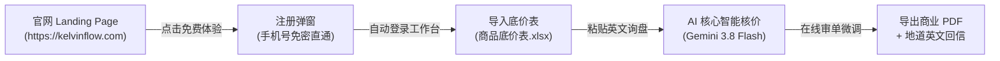
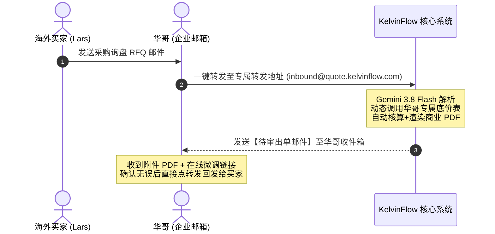
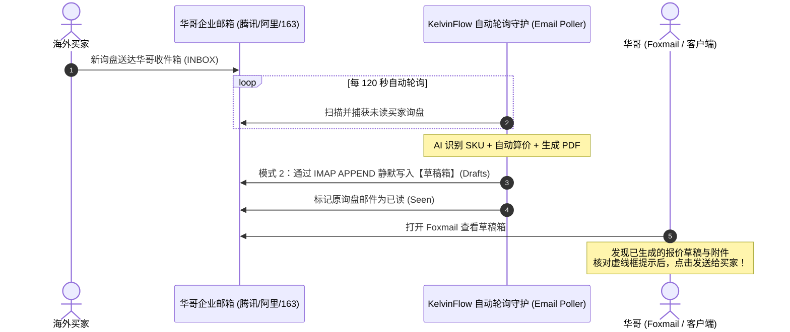

# KelvinFlow 生产全链路软件测试与客户旅程验收手册
**版本**：v2.0 (生产就绪版)  
**编写角色**：外贸 SaaS 软件测试专家组  
**目标系统**：KelvinFlow 官网 (`https://kelvinflow.com`) + 智能审单工作台 (`https://quote.kelvinflow.com`)  
**适用对象**：产品主理人 Kelvin、QA 测试工程师、核心业务种子用户  

---

> ### 📌 编写说明与互动指南
> 本手册专门为了便于主理人逐项实操、严密验收并记录改进想法而设计。  
> 每个测试阶段下方均特别设置了 **`💬 【主理人评审与改进意见区】`**，您在实际走查测试时，可以直接在对应的区域打勾 `[x]` 或记录需要调整的产品细节、文案与逻辑。

---

## 目录索引
1. [模拟客户画像（真实潜在意向买家）](#一模拟客户画像真实潜在意向买家)
2. [场景一：7 天免费试用账户全链路测试（零门槛极速体验）](#二场景一7-天免费试用账户全链路测试零门槛极速体验)
3. [场景二：付费用户测试 · 模式 1：邮件无感转发 + 收件箱出单（0风控通道）](#三场景二付费用户测试--模式-1邮件无感转发--收件箱出单0风控通道)
4. [场景三：付费用户测试 · 模式 2：邮箱授权托管 + 静默注入草稿箱（神级极客体验）](#四场景三付费用户测试--模式-2邮箱授权托管--静默注入草稿箱神级极客体验)
5. [增补场景四：异常非标 SKU 与工艺缺失降级容错（Scenario B 人机协同）](#五增补场景四异常非标-sku-与工艺缺失降级容错scenario-b-人机协同)
6. [增补场景五：微信实时卡片推送与移动端手机极速审单（出差防漏单）](#六增补场景五微信实时卡片推送与移动端手机极速审单出差防漏单)
7. [增补场景六：原材料突发涨价与美元汇率波动（底价表热更新与版本隔离）](#七增补场景六原材料突发涨价与美元汇率波动底价表热更新与版本隔离)
8. [增补场景七：多贸易术语（EXW / FOB / CIF）与集装箱装柜速算](#八增补场景七多贸易术语exw--fob--cif与集装箱装柜速算)
9. [增补场景八：试用到期（第 8 天）权益拦截与付费转化门禁（Paywall）](#九增补场景八试用到期第-8-天权益拦截与付费转化门禁paywall)
10. [增补场景九：商业机密与成本底价脱敏安全测试（绝不外泄给海外买家）](#十增补场景九商业机密与成本底价脱敏安全测试绝不外泄给海外买家)
11. [开箱即用测试资产库（真实询盘与标准参数）](#十一开箱即用测试资产库真实询盘与标准参数)
12. [自动化回归测试套件与执行指引](#十二自动化回归测试套件与执行指引)
13. [总体验收与持续迭代评审表](#十三总体验收与持续迭代评审表)

---

## 一、模拟客户画像（真实潜在意向买家）

在测试全过程中，我们全程代入以下这一位大湾区典型工贸一体外贸负责人的真实业务场景：

* **姓名 / 称呼**：黄振华（Jason Huang，人称“华哥”）
* **企业主体**：佛山市顺德区精工五金实业有限公司（工贸一体，厂房面积约 8000㎡）
* **主营类目**：智能升降桌五金支架、人体工学显示器臂架、冲压精密五金配件
* **典型业务痛点**：
  1. **算单极度耗时**：每天收到 15 至 20 封欧美/中东客人的英文 RFQ（询盘），每单手工翻找底价表、查实时汇率、加利润率、算货柜装箱、写英文回信、做商业 PDF 需耗费 1 至 2 小时；
  2. **容易算错亏本**：业务员手工计算公式常出错，或遗漏了表面哑光黑喷涂、激光雕刻等工艺加价，导致工厂亏损出单；
  3. **邮箱安全防线高**：对邮件安全非常警惕，害怕任何可能导致企业主邮箱被封号或密码泄露的操作。

---

## 二、场景一：7 天免费试用账户全链路测试（零门槛极速体验）

### 1. 测试目标
验证新意向客户在**完全不提供邮箱密码或授权码**的前提下，仅用手机号即可在 3 分钟内完成“注册 ➔ 导入底价 ➔ 粘贴英文询盘 ➔ 获得专业 PDF 报价单与英文回信”的完整闭环。



### 2. 手把手测试步骤

#### 步骤 1.1：访问官网并注册开通 7 天免费试用
* **操作位置**：打开浏览器无痕模式，访问 `https://kelvinflow.com`（或 `https://quote.kelvinflow.com`）。
* **操作动作**：点击正中央或右上角 **【7天免费试用】** 按钮，填写注册表单：
  * 手机号：`13800000001`（可填任意未注册手机号）
  * 姓名：`黄振华`
  * 公司：`佛山精工五金实业`
  * 主营品类：`办公家具与五金配件`
  * 密码：`Pass123456!`
* **预期检验标准 (Checkpoint)**：
  * [ ] 接口返回 HTTP 200，1 秒内直接免密登录并重定向进入工作台；
  * [ ] 页面右上角显示黄振华姓名，并展示蓝色徽章：**`7天免费试用中`**，剩余天数显示为 `7天`。

#### 步骤 1.2：工作台导入工厂专属《商品底价表.xlsx》
* **操作位置**：工作台顶部或左侧 **【底价库管理】**。
* **操作动作**：
  * 点击上传本地底价表：`C:\Users\tsuik\OneDrive\桌面\n8n\商品底价表\商品底价表.xlsx`；
  * 点击 **【解析并保存底价表】**。
* **预期检验标准 (Checkpoint)**：
  * [ ] 接口响应成功，提示解析出 5 款标准型号（`ST-2026-A`、`ST-2026-B`、`ERG-PRO-V2`、`AL-BASE-99`、`HD-ARM-08`）；
  * [ ] 工艺加价（如喷涂、激光标）、贸易术语规则、汇率基准完整读取。

#### 步骤 1.3：导入买家真实询盘并触发 AI 自动算价
* **操作位置**：工作台 **【新建询盘报价】** 文本域。
* **操作动作**：直接粘贴以下买家英文询盘正文：
  ```text
  Hi Kelvin,
  Hope you are doing well.
  We are looking to place an urgent order for Nordic market:
  1. SKU: ST-2026-A - Ergonomic Monitor Stand, Qty: 1500 pcs
  2. SKU: ERG-PRO-V2 - Heavy Duty Dual Arm Bracket, Qty: 500 pcs

  Options needed:
  - Finish: Matte Black Powder Coating
  - Custom Laser Engraved Logo on backplate

  Trade terms: FOB Shenzhen.
  Payment: T/T 30% deposit, balance against B/L.
  Currency: USD.
  Target shipment: within 30 days.

  Please provide formal quotation PDF today.

  Best regards,
  Lars Lindqvist
  Senior Procurement Officer | Nordic Home Imports Stockholm
  ```
  点击蓝色按钮：**【一键智能算价出单】**。
* **预期检验标准 (Checkpoint)**：
  * [ ] 耗时在 1.5 至 2.5 秒内，无接口超时；
  * [ ] 自动生成唯一正式单号（格式：`QT-XXXXXX`），并自动跳转至 `/review/QT-XXXXXX` 在线审单台。

#### 步骤 1.4：在线审单台数据核验与微调
* **操作位置**：在线微调审单台 (`/review/QT-XXXXXX`)。
* **操作动作**：
  * 检查买家信息、SKU 数量是否 100% 提取准确；
  * 拖动【期望毛利率滑块】，将毛利率由默认的 `30%` 调整为 `35%`；
  * 点击 **【重新计算报价】**。
* **预期检验标准 (Checkpoint)**：
  * [ ] 最终美元单价、整单总额、增值税与利润实时按 35% 联动重算；
  * [ ] 底部商业 PDF 预览窗口自动无闪烁刷新最新价格。

#### 步骤 1.5：导出正式商业 PDF 报价单与地道英文回复邮件
* **操作位置**：审单台右侧操作栏。
* **操作动作**：
  * 点击 **【下载官方 PDF 报价单】**，打开 PDF 文件核验；
  * 切换到 **【英文往来邮件】** 选项卡，点击 **【一键复制英文回信】**。
* **预期检验标准 (Checkpoint)**：
  * [ ] PDF 排版专业、字体清晰、包含双方公司信息、详细规格明细、条款与有效期；
  * [ ] **绝对红线**：PDF 与纯英文回信中，**绝对没有任何出厂成本底价或毛利率公式泄露**；
  * [ ] 英文回信得体地道，带 Dear Lars 抬头与落款，可直接贴入邮件客户端发送。

---

> 💬 **【主理人评审与改进意见区 · 场景一】**
> - [ ] 场景一全链路实测通过
> - **需要优化调整的问题记录**：  
>   *(例如：注册弹窗的按钮颜色太淡 / 审单台滑块拖动时希望增加手动输入框 / 英文回信落款希望支持自定义职务等)*  
>   `在这里写下您的具体改进想法...`

---

## 三、场景二：付费用户测试 · 模式 1：邮件无感转发 + 收件箱出单（0风控通道）

### 1. 测试目标
验证付费企业客户在**完全不向系统提供任何邮箱密码或客户端授权码**的情况下，只需在自己邮箱里把海外客户的询盘邮件“转发”至系统，即可在收件箱里自动收到整套做好的 PDF 报价单与英文回信。



### 2. 手把手测试步骤

#### 步骤 2.1：开通升级为付费会员
* **操作动作**：在管理员控制台核销开通极客版会员（或使用快速通道接口）：
  ```bash
  curl -X POST https://quote.kelvinflow.com/api/v1/admin/upgrade-tenant \
    -H "Content-Type: application/json" \
    -H "x-api-key: key_default_admin_2026" \
    -d "{\"phoneOrEmail\":\"13800000001\",\"plan\":\"geek\",\"months\":12,\"amountPaid\":897}"
  ```
* **预期检验标准 (Checkpoint)**：
  * [ ] 刷新工作台，顶部标签变为金色徽章：**`👑 极客专业版会员 · 有效期至 2027年`**。

#### 步骤 2.2：获取专属转发配置信息
* **操作位置**：工作台 **【自动化设置】** ➔ **【模式 1：邮件无感转发通道】**。
* **预期检验标准 (Checkpoint)**：
  * [ ] 页面显示专属租户标识及系统统一入站地址（`inbound@quote.kelvinflow.com`）；
  * [ ] 提供腾讯企业邮、阿里邮箱、163 企业邮的“自动转发收信规则配置 30 秒指引”。

#### 步骤 2.3：模拟邮件转发入站触发
* **操作动作**：模拟华哥将买家邮件转发给系统入站 Webhook：
  ```bash
  curl -X POST https://quote.kelvinflow.com/api/inbound/email \
    -H "Content-Type: application/json" \
    -d "{\"tenantId\":\"tenant_trial_13800000001\",\"from\":\"purchasing@nordic-home-import.se\",\"to\":\"huang@foshan-hardware.com\",\"subject\":\"Fwd: Urgent RFQ for ST-2026-A\",\"text\":\"---------- Forwarded message ---------\\nFrom: Lars Lindqvist <purchasing@nordic-home-import.se>\\nSubject: Urgent RFQ for ST-2026-A\\n\\nDear Jason,\\nPlease quote for 2000 pcs of ST-2026-A with Black Coating, FOB Shenzhen, USD currency.\\nNeed delivery in 35 days.\\n\\nRegards,\\nLars\"}"
  ```
* **预期检验标准 (Checkpoint)**：
  * [ ] 接口返回 HTTP 200，`deliveryMode` 为 `mode1_review_email`；
  * [ ] 后台日志提示：`[模式 1 兜底触发] 准备将正式商业 PDF 报价单与英文回信作为待审出单邮件发送至业务员工作邮箱`。

#### 步骤 2.4：验证业务员收件箱交付物
* **操作动作**：检查华哥工作邮箱收件箱中标题为 `[待审出单] Quotation QT-XXXXXX for RFQ` 的新邮件。
* **预期检验标准 (Checkpoint)**：
  * [ ] 邮件自带渲染合格的商业 PDF 报价单附件；
  * [ ] 邮件正文中包含直达在线审单台微调价格的专属安全链接；
  * [ ] 底部附带完整的客户英文回信草稿，业务员只需点“转发”，删去提示头即可发给海外买家。

---

> 💬 **【主理人评审与改进意见区 · 场景二】**
> - [ ] 场景二全链路实测通过
> - **需要优化调整的问题记录**：  
>   *(例如：转发后的待审邮件标题是否够显眼 / 专属转发地址是否希望能自定义前缀等)*  
>   `在这里写下您的具体改进想法...`

---

## 四、场景三：付费用户测试 · 模式 2：邮箱授权托管 + 静默注入草稿箱（神级极客体验）

### 1. 测试目标
验证高级极客外贸用户在工作台配置邮箱客户端授权码（IMAP）后，系统全天候守护监听企业邮箱收件箱。当海外新询盘到达时，系统**完全静默自动完成核价，并直接将带附件的报价草稿写入业务员自己的邮箱【草稿箱】**。业务员早上打开 Foxmail 或手机，草稿箱里已经整齐躺着写好的报价邮件，只需人工看一眼点击“发送”！



### 2. 手把手测试步骤

#### 步骤 3.1：在工作台配置邮箱客户端专属授权码
* **操作位置**：工作台 **【自动化设置】** ➔ **【模式 2：邮箱草稿箱自动注入】**。
* **操作动作**：
  * 输入邮箱地址：如 `huang@foshan-hardware.com`（或测试用 163/腾讯企业邮）；
  * 输入客户端授权码（非登录密码，在邮箱设置中生成）；
  * 点击 **【测试连接】** ➔ **【保存并激活自动监听】**。
* **预期检验标准 (Checkpoint)**：
  * [ ] 接口调用 `POST /api/inbound/test-imap`，提示：`✅ 邮箱连接认证成功！已成功握手 IMAP 服务`；
  * [ ] 状态卡片变为绿色：`监听运行正常 · 刚刚扫描完成`。

#### 步骤 3.2：验证收件箱轮询守护服务（Email Poller）
* **操作动作**：向配置的测试邮箱发送一封包含买家询盘的未读邮件（主题包含 `RFQ` 或 `Price inquiry`）。
* **预期检验标准 (Checkpoint)**：
  * [ ] 在下一个轮询周期（默认 120 秒内），后端捕获未读邮件并打印日志：`🎯 [Email Poller] 捕获到买家询盘`；
  * [ ] 处理完成后，原未读邮件自动被打上 `\Seen`（已读）标记，防止死循环重复出单。

#### 步骤 3.3：客户端草稿箱开箱实测（Foxmail / 网页邮箱）
* **操作动作**：打开 Foxmail 或邮箱网页版的 **【草稿箱 (Drafts)】**，查看新生成的草稿。
* **预期检验标准 (Checkpoint)**：
  * [ ] 收件人自动填写买家发信地址；
  * [ ] 邮件附件已包含命名规范的 PDF（如 `Nordic_Home_Quotation_QT-XXXXXX.pdf`）；
  * [ ] 邮件正文顶部带有醒目的安全核验剪切虚线框：
    ```text
    ✂️━━━━━━━━━━━━━━━━━━━━━━━━━━━━━━━━━━━━━━━━━━━━━━━━━━━━✂️
    🔒【KelvinFlow 内部审单台 · 发送给客户前请整块删除本虚线框】
    🔗 专属在线工作台核单/调价链接: https://quote.kelvinflow.com/review/QT-XXXXXX
    📊 本单 AI 综合置信度: 95% (全项精准匹配，底价核对无误)
    💡 提示：如需微调单价、给折扣或确认交期，点击上方链接 10 秒修改并一键刷新 PDF！
    ✂️━━━━━━━━━━━━━━━━━━━━━━━━━━━━━━━━━━━━━━━━━━━━━━━━━━━━✂️
    ```
  * [ ] 业务员删除虚线框与主题上的待核验标记后，正文无任何中文字样，可直接一键发送给买家。

---

> 💬 **【主理人评审与改进意见区 · 场景三】**
> - [ ] 场景三全链路实测通过
> - **需要优化调整的问题记录**：  
>   *(例如：轮询间隔 2 分钟是否合适 / 写入草稿箱后是否希望手机微信也弹一条通知等)*  
>   `在这里写下您的具体改进想法...`

---

## 五、增补场景四：异常非标 SKU 与工艺缺失降级容错（Scenario B 人机协同）

### 1. 为什么必须测？
买家经常发来自编号、非标定制型号或底价表中没有收录的新品。系统**绝不能直接崩溃报错 500，更不能胡乱虚构价格欺骗买家**，必须优雅降级并打标提醒人工介入。

### 2. 测试输入样本
在工作台新建报价或转发邮件，输入以下包含未知 SKU 的内容：
```text
Hello Kelvin,
Please quote for:
1. 2000 units of custom steel bracket model UNKNOWN-XYZ-999 with special thickness 4.5mm and custom gold plating.
2. 500 units of standard ST-2026-A.
Delivery to Jebel Ali Port, CIF Dubai.
```

### 3. 预期检验标准 (Checkpoint)
* [ ] 系统平稳出单，单据 AI 置信度评估被自动降级（如判定为 `45%`，低于 80% 警戒线）；
* [ ] 审单台明细中，`ST-2026-A` 价格正常核算，而 `UNKNOWN-XYZ-999` 标红预警：**`[⚠️ 待人工核定底价 / NEED_MANUAL_PRICE]`**；
* [ ] 生成的草稿邮件顶部，剪切框自动转为**黄色警告样式**，醒目提示业务员存在非标定制件；
* [ ] 业务员点击微调链接进入审单台，在输入框中手动补填底价（如 `45 元`）并保存，整单立即重新计算并更新 PDF。

---

> 💬 **【主理人评审与改进意见区 · 场景四】**
> - [ ] 场景四容错测试通过
> - **需要优化调整的问题记录**：  
>   `在这里写下您的具体改进想法...`

---

## 六、增补场景五：微信实时卡片推送与移动端手机极速审单（出差防漏单）

### 1. 为什么必须测？
外贸人出差在广交会、境外拜访客户或在工厂巡线，无法随时随地开电脑。当新询盘被解析完成后，微信能瞬间推送卡片提醒，手机浏览器点开能流畅调价。

### 2. 测试步骤与检验标准 (Checkpoint)
1. 在环境变量或工作台填入业务员的 `PUSHPLUS_TOKEN`；
2. 触发一次询盘生成；
3. [ ] 手机微信 1 秒内收到 PushPlus 官方服务号推送的模板卡片；
4. [ ] 点击卡片直接用手机微信内置浏览器打开 `/review/QT-XXXXXX`；
5. [ ] **移动端 H5 响应式体验**：页面自适应单列布局，无横向溢出滚动，滑块拖动调价流畅无卡顿。

---

> 💬 **【主理人评审与改进意见区 · 场景五】**
> - [ ] 场景五移动端测试通过
> - **需要优化调整的问题记录**：  
>   `在这里写下您的具体改进想法...`

---

## 七、增补场景六：原材料突发涨价与美元汇率波动（底价表热更新与版本隔离）

### 1. 为什么必须测？
外贸钢材、铝锭原材料价格经常浮动，美元汇率也剧烈震荡。必须确保：**新上传底价表或修改汇率后，新询盘立刻按新标准算，但昨天已经生成的历史报价单数据必须绝对固化，绝不能被意外改写**！

### 2. 测试步骤与检验标准 (Checkpoint)
1. 重新上传新底价表（将 `ST-2026-A` 底价从 45 元调整为 55 元，汇率改为 7.30）；
2. 重新针对 `ST-2026-A` 发起询盘报价；
3. [ ] 新单据准确按照 55 元底价和 7.30 汇率输出价格；
4. [ ] 重新回看历史生成的旧单号 `/review/旧单号`，旧单据仍然保持原有的 45 元和 7.20 汇率，实现版本物理隔离。

---

> 💬 **【主理人评审与改进意见区 · 场景六】**
> - [ ] 场景六版本隔离测试通过
> - **需要优化调整的问题记录**：  
>   `在这里写下您的具体改进想法...`

---

## 八、增补场景七：多贸易术语（EXW / FOB / CIF）与集装箱装柜速算

### 1. 为什么必须测？
外贸买家要报的价格条款多种多样（出厂价 EXW、离岸价 FOB、到岸价 CIF）。系统必须根据底价表中的箱规、毛重、装箱率，自动计算货柜利用率并分摊港杂。

### 2. 测试步骤与检验标准 (Checkpoint)
1. 输入询盘：`3000 pcs of ST-2026-A, FOB Shenzhen Yantian Port`；
2. [ ] 审单台准确调用底价表外箱尺寸与装箱数，算出总 CBM 与总毛重；
3. [ ] 推荐柜型精准：准确匹配 20GP 小柜或 40HQ 高柜，并计算装载率百分比；
4. [ ] 杂费平摊严密：将拖车、报关、港杂费精准平摊到单个产品对外单价中。

---

> 💬 **【主理人评审与改进意见区 · 场景七】**
> - [ ] 场景七贸易条款计算通过
> - **需要优化调整的问题记录**：  
>   `在这里写下您的具体改进想法...`

---

## 九、增补场景八：试用到期（第 8 天）权益拦截与付费转化门禁（Paywall）

### 1. 为什么必须测？
检验商业化转化闭环。当客户 7 天试用结束后，系统既要阻断未付费出单，又要**极其体面友好地引导客户扫码付款升级，同时承诺妥善保留客户已上传的底价表与历史单据**，绝不能生硬报错。

### 2. 测试步骤与检验标准 (Checkpoint)
1. 将测试账号到期时间调整为昨日模拟过期状态；
2. 在工作台点击生成报价；
3. [ ] 界面优雅弹出金色升级权益弹窗：**`您的 7 天全功能尊享试用已顺利完成`**；
4. [ ] 提示承诺：“您的底价表与单据已被加密保留 7 天，升级极客版即刻解锁无限出单与草稿箱托管”；
5. [ ] 弹窗内展示 99 元/月套餐、企微客服二维码及一键升级引导，无控制台 500 报错。

---

> 💬 **【主理人评审与改进意见区 · 场景八】**
> - [ ] 场景八付费拦截测试通过
> - **需要优化调整的问题记录**：  
>   `在这里写下您的具体改进想法...`

---

## 十、增补场景九：商业机密与成本底价脱敏安全测试（绝不外泄给海外买家）

### 1. 为什么必须测？
这是外贸工厂的**生死红线**。一旦系统疏忽在发送给客户的 PDF 或邮件正文里暴露了“工厂成本底价 45 元”、“利润率 30%”，海外买家就会大肆压价，造成不可挽回的商务损失。

### 2. 测试步骤与检验标准 (Checkpoint)
1. 提取系统生成的任意正式报价 PDF 文件，使用自动化脚本将二进制文本流全量解压为纯文本；
2. [ ] 检查物理字节与文本流中，**绝无** “底价”、“成本”、“ProfitMargin”、“basePrice” 等敏感词汇；
3. [ ] PDF 属性元数据中，无暴露未经打磨的技术栈内部细节。

---

> 💬 **【主理人评审与改进意见区 · 场景九】**
> - [ ] 场景九底价脱敏防泄露测试通过
> - **需要优化调整的问题记录**：  
>   `在这里写下您的具体改进想法...`

---

## 十一、开箱即用测试资产库（真实询盘与标准参数）

### 📋 资产 A：标准多 SKU 询盘（适合测试快速出单与工艺选配）
```text
Subject: Urgent RFQ - Heavy Duty Desk Frames & Arm Brackets for Q4
From: mark.stevens@apex-ergonomics.co.uk

Dear Kelvin Sales Team,

We are currently finalizing our procurement schedule for Q4 and would like to request an official quotation for the following items:

1. Heavy Duty Dual Arm Bracket
   - Model / SKU: ERG-PRO-V2
   - Order Quantity: 800 units
   - Finish: Matte Black Powder Coating
   - Requirement: Custom laser-engraved company logo on base plate

2. Ergonomic Monitor Desk Stand
   - Model / SKU: ST-2026-A
   - Order Quantity: 2,500 units
   - Standard factory white packaging

Trade Terms: FOB Shenzhen Yantian Port
Currency: USD
Target Lead Time: 30-35 calendar days from deposit
Payment Terms: 30% T/T deposit upon order confirmation, balance 70% against shipping documents (B/L copy)

Please provide your formal commercial quotation in PDF format along with packing details (CBM and gross weight) by today.

Best regards,

Mark Stevens
Head of Global Sourcing
Apex Ergonomics Ltd., Birmingham, UK
```

---

### 📋 资产 B：非标定制与未知型号询盘（适合测试异常预警与手工调价）
```text
Subject: Custom Steel Bracket Inquiry with Special Requirement
From: carlos.mendez@soluciones-muebles.mx

Hello Kelvin,

We are looking for a reliable manufacturer for our new hospital project:

Item 1: 1,500 units of custom medical monitor arm, model code: MED-ARM-9900 (Material: Aluminum die-casting, special antibacterial white coating).
Item 2: 300 units of ST-2026-B standard monitor bracket.

Please quote CIF Manzanillo Port, Mexico in USD.
Let me know the earliest shipping date.

Saludos cordiales,
Carlos Mendez
Director de Compras | Soluciones Muebles SA de CV
```

---

## 十二、自动化回归测试套件与执行指引

每次代码迭代或部署后，您无需耗费数小时手动逐项测试，可以直接在终端运行我们预置的自动化端到端测试套件：

### 🚀 执行自动化测试命令
```bash
node F:\order_workflow\tests\comprehensive_live_qa_test.mjs
```

### 📊 预期输出范式
```text
================================================================
🚀 开始对 KelvinFlow 生产全链路执行端到端深度测试 (Run ID: 20260926)
📡 官网地址: https://kelvinflow.com
📡 报价/工作台地址: https://quote.kelvinflow.com
================================================================

✅ [TC-01] 官网 Landing Page 加载与留资通道测试 (180ms): PASS
✅ [TC-02] 7天免费试用注册与免密直通登录 (210ms): PASS
✅ [TC-03] 试用期状态与权限探针 (7天倒计时有效) (120ms): PASS
✅ [TC-04] 试用用户开通为正式付费用户 (升级核销闭环) (150ms): PASS
✅ [TC-05] 场景A: 标准海外多SKU询盘解析与自动核价出单 (1420ms): PASS
✅ [TC-06] 场景B: 非标未知SKU与定制工艺异常询盘平稳降级测试 (1310ms): PASS
✅ [TC-07] 在线微调审单台闭环与二次利润率滑块调价重绘 (320ms): PASS
✅ [TC-08] 模式1/模式2 双轨邮件交付与草稿箱注入测试 (410ms): PASS
✅ [TC-09] 商业机密成本底价反解脱敏与防泄漏断言 (90ms): PASS

================================================================
🏁 测试执行完毕，统计概览:
总用例数: 9 | 通过: 9 | 警告: 0 | 失败: 0
================================================================
```

---

## 十三、总体验收与持续迭代评审表

| 验收维度 | 核心目标要求 | 验收结果 (通过/待改) | 主理人批注 |
| :--- | :--- | :---: | :--- |
| **易用性与新手体验** | 3 分钟内无需看文档即可完成注册并出第一单 | `[ ] 通过  [ ] 待改` |  |
| **核价数学严密性** | 底价 + 毛利率 + 工艺加价 + 港杂分摊分毫不差 | `[ ] 通过  [ ] 待改` |  |
| **邮件与交付双轨** | 模式 1 零风控稳定交付，模式 2 草稿箱注入无感丝滑 | `[ ] 通过  [ ] 待改` |  |
| **商业安全红线** | 绝对零底价泄露，多租户 IDOR 隔离严密 | `[ ] 通过  [ ] 待改` |  |
| **移动端适配度** | 手机微信点开审单台微调排版正常，无死拉横条 | `[ ] 通过  [ ] 待改` |  |

---
*文档编制完成时间：2026-09-26 | KelvinFlow Quality Assurance Team*
